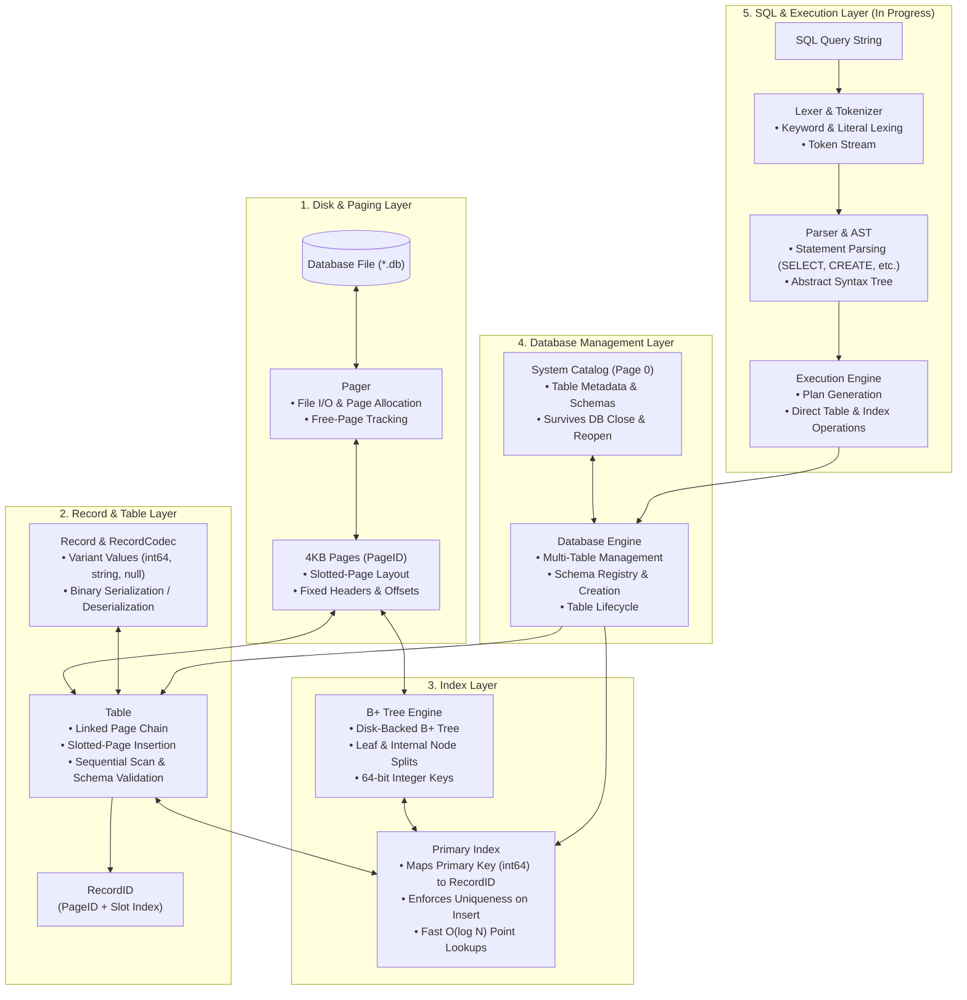

# QuartzDB 💎

QuartzDB is a lightweight, embedded relational database engine written in modern C++23 from scratch. Designed for educational depth and high clarity, it features a slotted-page disk storage engine, a disk-backed B+ tree index, strict schema enforcement, and a modular architecture paving the way toward a full embedded SQL engine.

---

## Architecture Diagram

The system is structured as a layered storage and execution pipeline:



---

## Architectural Breakdown

### 1. Pager (`storage/pager.hpp`, `src/storage/pager.cpp`)
- **Page-Based Storage**: Manages low-level file I/O operations using fixed 4KB page boundaries.
- **Allocation & Recycling**: Handles dynamic page allocation and tracks free pages across database sessions.
- **Reserved Catalog Page**: Page 0 is reserved for database catalog and metadata persistence.

### 2. Record & Slotted Page Storage (`storage/record.hpp`, `storage/table.hpp`, `src/storage/table.cpp`)
- **Dynamic Values**: Typed records supporting `std::int64_t`, `std::string`, and `std::monostate` (NULL) via `std::variant`.
- **Slotted-Page Architecture**: Each 4KB data page maintains:
  - Header: Magic number, version, slot count, free-space bounds, and pointer to the next page.
  - Slot Array: Located at the beginning of the page, growing forward with record offsets and lengths.
  - Record Payloads: Located at the end of the page, growing backward.
- **Record Addressing**: Every record is uniquely referenced by a `RecordID` (`{PageID, slot_index}`).
- **Schema Validation**: Enforces column data types, nullability constraints, and single-column primary keys.

### 3. Primary Index & B+ Tree (`index/bplus_tree.hpp`, `index/primary_index.hpp`)
- **Disk-Backed B+ Tree**: All index nodes (leaves and internal nodes) persist directly onto database pages allocated by the pager.
- **Balanced Splitting**: Automatically handles leaf and internal node splits and root promotion as records are inserted.
- **Primary Key Mapping**: `PrimaryIndex` binds 64-bit integer primary keys to `RecordID`s, enforcing uniqueness on `insert()` and providing $O(\log N)$ indexed lookups via `find_by_primary_key()`.

### 4. Database Catalog (`quartz/database.hpp`, `src/quartz/database.cpp`)
- **Multi-Table Registry**: Allows creating and retrieving independent tables within a single database file.
- **Metadata Persistence**: Saves table names, schema definitions, and root data pages to Page 0, surviving database close and reload cycles.

### 5. SQL Layer (`sql/token.hpp`, `src/sql/`, `src/execution/`) *(Under Development)*
- **Lexer**: Tokenizes SQL statements into executable tokens (`CREATE`, `SELECT`, `WHERE`, `JOIN`, `DROP`, `TRUNCATE`).
- **Parser**: Converts token streams into an Abstract Syntax Tree (AST).
- **Executor**: Executes plans against the database and table APIs.

---

## Building and Testing

### Prerequisites
- C++23 compliant compiler (MSVC 2022+ / GCC 13+ / Clang 17+)
- CMake 3.25 or higher

### Build Instructions

```bash
# Configure the build directory
cmake -B build -S .

# Build the project and test suite
cmake --build build --config Debug
```

### Running Tests

```bash
# Run all unit tests via CTest
ctest --test-dir build --output-on-failure
```

---

## License

This project is open-source and available under the [MIT License](LICENSE).
