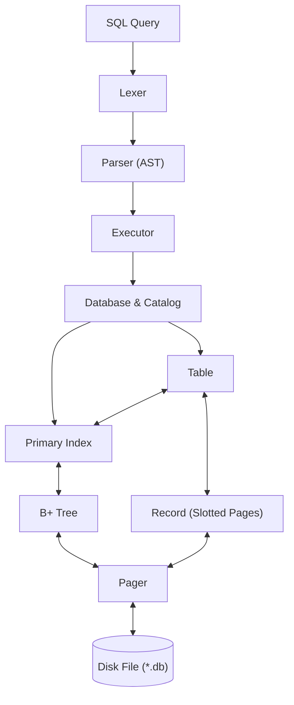

# QuartzDB 💎

QuartzDB is a lightweight, embedded relational database engine written in modern C++23 from scratch. Designed for educational depth and high clarity, it features a slotted-page disk storage engine, a disk-backed B+ tree index, strict schema enforcement, and a modular architecture paving the way toward a full embedded SQL engine.

---

## Architecture Diagram

The system is structured as a layered storage and execution pipeline:



---

## Architectural Breakdown

### 1. Pager (`storage/pager.hpp`, `src/storage/pager.cpp`)
- **Page-Based Storage**: Manages low-level file I/O operations using fixed 4KB page boundaries.
- **Allocation & Recycling**: Handles dynamic page allocation and tracks free pages across database sessions.
- **Reserved Catalog Page**: Page 0 is reserved for database catalog and metadata persistence.

### 2. Record & Slotted Page Storage (`storage/record.hpp`, `storage/table.hpp`, `src/storage/table.cpp`)
- **Dynamic Values**: Typed records supporting `std::int64_t`, `std::string`, and `std::monostate` (NULL) via `std::variant`.
- **Slotted-Page Architecture**: Each 4KB data page maintains:
  - Header: Magic number, version, slot count, free-space bounds, and pointer to the next page.
  - Slot Array: Located at the beginning of the page, growing forward with record offsets and lengths.
  - Record Payloads: Located at the end of the page, growing backward.
- **Record Addressing**: Every record is uniquely referenced by a `RecordID` (`{PageID, slot_index}`).
- **Schema Validation**: Enforces column data types, nullability constraints, and single-column primary keys.

### 3. Primary Index & B+ Tree (`index/bplus_tree.hpp`, `index/primary_index.hpp`)
- **Disk-Backed B+ Tree**: All index nodes (leaves and internal nodes) persist directly onto database pages allocated by the pager.
- **Balanced Splitting**: Automatically handles leaf and internal node splits and root promotion as records are inserted.
- **Primary Key Mapping**: `PrimaryIndex` binds 64-bit integer primary keys to `RecordID`s, enforcing uniqueness on `insert()` and providing $O(\log N)$ indexed lookups via `find_by_primary_key()`.

### 4. Database Catalog (`quartz/database.hpp`, `src/quartz/database.cpp`)
- **Multi-Table Registry**: Allows creating and retrieving independent tables within a single database file.
- **Metadata Persistence**: Saves table names, schema definitions, and root data pages to Page 0, surviving database close and reload cycles.

### 5. SQL Layer (`include/sql/`, `src/sql/`, `src/execution/`, `src/cli/`)
- **Lexer**: Hand-written token scanner supporting keywords, identifiers, string literals with escapes, numbers, and comparison operators.
- **Parser**: Hand-written recursive-descent AST parser generating type-safe statement variants (`CREATE TABLE`, `DROP TABLE`, `INSERT`, `SELECT`, `UPDATE`, `DELETE`).
- **Executor**: Executes plans with expression evaluation, filtering, column projections, and $O(\log N)$ fast-path B+ tree index lookups.
- **Interactive CLI**: Production REPL shell (`quartz.exe`) with multi-line query accumulation, dynamic database creation/switching (`CREATE DATABASE`, `USE`, `.open`), schema inspection (`.schema`, `.tables`), and pretty-printed tabular output.

---

## Benchmarks

### SQL Engine Scale & Limits Benchmark
Evaluated end-to-end on an interactive SQL engine workload (Lexer $\to$ Parser $\to$ Query Executor $\to$ Slotted Pages & B+ Tree Index) scaling from 100 to 120,000+ records:

```text
===================================================================
       QUARTZ DB - SQL ENGINE SCALE & LIMITS BENCHMARK
===================================================================

+---------+----------------------+----------------------+------------------+
| Scale   | SQL Writes (INSERT)  | SQL Reads (SELECT)   | Disk Footprint   |
| Rows    | Throughput / Latency | Throughput / Latency | File Size / Pgs  |
+---------+----------------------+----------------------+------------------+
| 100     | 2720 qps (367.6 us)  | 3349 qps (298.6 us)  | 16 KB (4 pgs)    |
| 1000    | 2247 qps (445.0 us)  | 3228 qps (309.8 us)  | 112 KB (28 pgs)  |
| 10000   | 1932 qps (517.3 us)  | 2760 qps (362.3 us)  | 1.00 MB (257 pgs) |
| 50000   | 3263 qps (306.4 us)  | 9987 qps (100.1 us)  | 5.03 MB (1288 pgs) |
| 100000  | 3496 qps (286.0 us)  | 2848 qps (351.1 us)  | 10.06 MB (2576 pgs) |
| 120000  | 2219 qps (450.7 us)  | 3032 qps (329.7 us)  | 12.09 MB (3094 pgs) |
+---------+----------------------+----------------------+------------------+
```

- **Sustained Throughput**: Maintained 2,000–3,500+ QPS across 120,000 continuous SQL inserts and reads.
- **Logarithmic Point Reads**: Fast-path primary-key point lookups via B+ tree ($O(\log N)$) consistently execute in sub-millisecond latencies ($\sim 100\text{--}360\,\mu\text{s}$) across all scales.
- **Compact Disk Utilization**: Entire 120,000-row table and multi-level B+ tree index requires only $\sim 12.09\text{ MB}$ on disk.

---

## Building and Testing

### Prerequisites
- C++23 compliant compiler (MSVC 2022+ / GCC 13+ / Clang 17+)
- CMake 3.25 or higher

### Build Instructions

```bash
# Configure the build directory
cmake -B build -S .

# Build the project and test suite
cmake --build build --config Debug
```

### Running Tests

```bash
# Run all unit tests via CTest
ctest --test-dir build --output-on-failure

# Or run the test executable directly
./build/quartz_tests
```

---

## Test Suite & Verification

QuartzDB is covered by an extensive test suite built on **GoogleTest (v1.15.2)** spanning all architectural layers—from low-level 4KB page persistence and B+ tree node rebalancing up to relational joins, expression evaluation, and 120,000-row scale benchmarks.

```
Total Test Suites : 12
Total Tests       : 84
Pass Rate         : 100% (84/84 passing)
```

### Test Suite Overview

| Suite Name | Source File | Tests | Target Subsystem | Scope & Verification |
| :--- | :--- | :---: | :--- | :--- |
| **`LegacyTests`** | `table_tests.cpp`, `persistence_allocation_tests.cpp` | 2 | Storage & Pager | Slotted-page allocation, record appending, and survival across multiple database restarts. |
| **`DatabaseTest`** | `database_tests.cpp` | 12 | Catalog & Page 0 | Table creation, catalog isolation, schema recovery, and malformed file rejection. |
| **`SchemaTest`** | `schema_tests.cpp` | 9 | Schema Engine | Column type constraints, nullability, primary key constraints, and schema persistence. |
| **`BPlusTreeTest`** | `bplus_tree_tests.cpp` | 3 | B+ Tree Core | Leaf splitting, internal node splitting, root promotion, and on-disk key lookups. |
| **`PrimaryIndexTest`** | `primary_index_tests.cpp` | 8 | Primary Index | Key-to-RecordID binding, duplicate key rejection, boundary values, and leaf split stability. |
| **`BplusTreeDeletionTest`** | `bplus_tree_deletion_tests.cpp` | 12 | Deletion & Compaction | Underflow handling, sibling borrowing, node merging, root collapse, and page deallocation. |
| **`BplusTreeHighFrequencyTest`** | `bplus_tree_deletion_tests.cpp` | 3 | Stress & Freelist | Sliding-window churn, sawtooth expansion/collapse, and 60,000-op adversarial blitz. |
| **`BplusDBTest`** | `bplus_tree_deletion_tests.cpp` | 2 | Full-Stack Integration | 10,000-op mixed OLTP churn, crash recovery, and multi-session catalog integrity. |
| **`LexerTest`** | `sql_tests.cpp` | 9 | SQL Lexer | Tokenization of DDL/DML, case insensitivity, string escapes, comments, and operator tokens. |
| **`ParserTest`** | `sql_tests.cpp` | 9 | SQL AST Parser | Recursive-descent AST construction, precedence parsing (AND > OR), and JOIN syntax parsing. |
| **`SQLExecutorTest`** | `sql_tests.cpp` | 8 | SQL Query Engine | End-to-end CRUD, B+ tree fast path, compound WHERE filters, DROP TABLE, non-PK UPDATE/DELETE, and JOIN execution. |
| **`SQLScaleTest`** | `sql_scale_tests.cpp` | 7 | Limits & Benchmarks | 100 to 120,000 row progressive benchmarks measuring QPS, read latency, and disk footprint. |

> For comprehensive, test-by-test specifications, see [docs/TESTING.md](docs/TESTING.md).

### Filtering & Targeted Testing

```bash
# Run only SQL executor & join tests
./quartz_tests --gtest_filter=SQLExecutorTest.*

# Run only SQL parser tests
./quartz_tests --gtest_filter=ParserTest.*

# Run B+ tree deletion and rebalancing tests
./quartz_tests --gtest_filter=BplusTreeDeletionTest.*

# Run the full 120,000-row scale benchmark
./quartz_tests --gtest_filter=SQLScaleTest.FullProgressionAndLimitsMatrix
```

---

## License

This project is open-source and available under the [MIT License](LICENSE).
