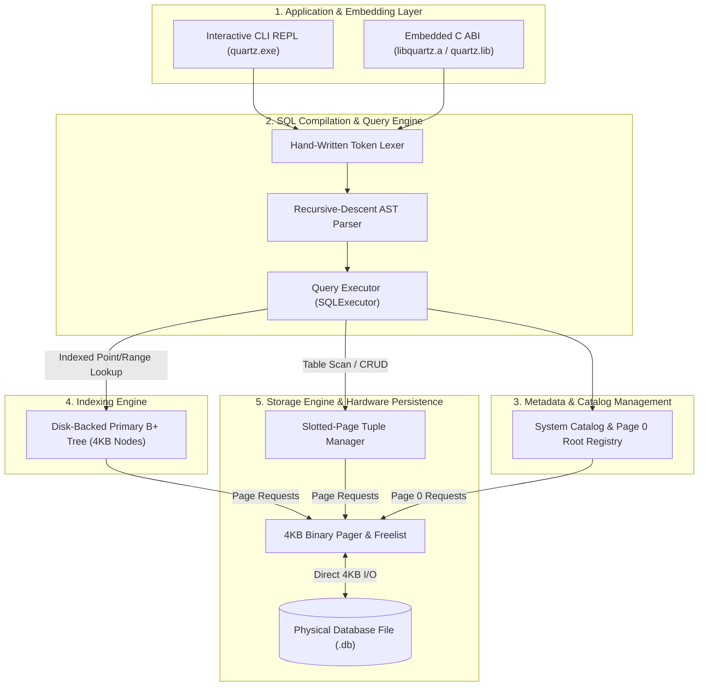

<p align="center">
  <a href="https://github.com/KAAZamapiloT/QUARTZ_DB">
    
  </a>
</p>

<h1 align="center">QuartzDB</h1>

<p align="center">
  <strong>A Lightweight, Hardware-Aligned Embedded Relational Database Engine in Modern C++23</strong><br>
  <em>Dual-Ended Slotted Pages • On-Disk B+ Tree Indexing • ANSI SQL Engine • Zero-Cost C ABI</em>
</p>

<p align="center">
  <a href="https://en.cppreference.com/w/cpp/23"></a>
  <a href="https://cmake.org"></a>
  <a href="#test-suite--verification"></a>
  <a href="#scale--limits-benchmarks"></a>
  <a href="LICENSE"></a>
  <a href="https://github.com/KAAZamapiloT/QUARTZ_DB"></a>
</p>

<p align="center">
  <a href="#system-architecture">Architecture</a> •
  <a href="#slotted-page-storage-architecture">Slotted Pages</a> •
  <a href="#on-disk-b-tree-indexing">B+ Tree</a> •
  <a href="#sql-engine--relational-algebra">SQL Engine</a> •
  <a href="#embedded-c-api-libquartz">Embedded C ABI</a> •
  <a href="#scale--limits-benchmarks">Benchmarks</a> •
  <a href="#demonstrations--quickstart">Quickstart</a> •
  <a href="#test-suite--verification">Test Suite</a>
</p>

---

## Overview

**QuartzDB** is a self-contained, embedded relational database engine written from first principles in **pure C++23** with **zero external dependencies**. It bridges the gap between toy in-memory key-value stores (which lose data on restarts) and heavy client-server engines like PostgreSQL or MySQL (which require background daemons and network sockets).

### Core Highlights
* **Hardware-Aligned 4KB Binary Pager**: Reads and writes conform to physical 4,096-byte page boundaries for direct OS page-cache alignment.
* **Dual-Ended Slotted-Page Architecture**: Solves variable-length text fragmentation; provides permanent immutable `RecordID {PageID, SlotIndex}` addressing.
* **Disk-Backed B+ Tree Index**: Self-balancing tree with 4KB page nodes, keeping tree height $\le 3$ for $>120,000$ rows with doubly-linked leaf chaining for instant range scans.
* **Recursive-Descent SQL Engine**: Hand-written lexer and precedence-climbing parser supporting `CREATE TABLE`, `DROP TABLE`, `INSERT`, `SELECT`, `UPDATE`, `DELETE`, `INNER/LEFT JOIN`, multi-column `ORDER BY`, `LIMIT/OFFSET`, and SQL Aggregates (`COUNT`, `SUM`, `AVG`, `MIN`, `MAX`).
* **Universal C ABI (`libquartz`)**: Standalone C header (`<quartz/quartz.h>`) and static library (`quartz.lib` / `libquartz.a`) for native embedding in C, C++, Python (ctypes), Rust, Go, and Zig.
* **Production Verification**: 13 GoogleTest test suites comprising 95 unit and stress tests with a 100% pass rate.

---

## System Architecture

QuartzDB enforces strict, invariant-governed boundaries across a 5-layer pipeline:

<p align="center">
  
</p>

### End-to-End Architectural Pipeline



---

## Slotted-Page Storage Architecture

Variable-length records (`TEXT`) cause severe internal fragmentation if placed in fixed-width slots. QuartzDB eliminates this using a **dual-ended slotted-page architecture**:

<p align="center">
  
</p>

### Memory Layout Breakdown

```
+------------------------------------------------------------------------+
| Byte 0..23: PAGE HEADER                                                |
| Magic (0x31424451) | Slot Count | FreeSpacePtr | NextPageID            |
+------------------------------------------------------------------------+
| Slot 0: [Offset: 4020, Len: 76]  ===> GROWS FORWARD                    |
| Slot 1: [Offset: 3950, Len: 70]                                        |
| Slot 2: [Offset: 3880, Len: 70]                                        |
+ - - - - - - - - - - - - - - - - - - - - - - - - - - - - - - - - - - - -+
|                       CONTIGUOUS FREE SPACE                            |
|             (New tuple insertions claim space here)                    |
+ - - - - - - - - - - - - - - - - - - - - - - - - - - - - - - - - - - - -+
| Record 2 Payload: [ID: 3, Name: "Charlie", Dept: 1]                    |
| Record 1 Payload: [ID: 2, Name: "Bob", Dept: 2]                        |
| Record 0 Payload: [ID: 1, Name: "Alice", Dept: 1]  <=== GROWS BACKWARD |
+------------------------------------------------------------------------+
| Byte 4096: END OF 4KB DISK PAGE                                        |
+------------------------------------------------------------------------+
```

* **Slot Array (Grows Forward)**: Positioned at the top of the page immediately following the 24-byte header. Each 16-bit slot stores `offset` and `length` pointers.
* **Payloads (Grow Backward)**: Record data bytes are appended from the end of the page (byte 4096) backward toward the slot array.
* **Permanent `RecordID` Addressing**: Records maintain a permanent `{PageID, SlotIndex}` identifier for life, enabling $O(1)$ tuple pointer dereferencing.
* **In-Page Compaction**: Deleting records creates fragmented gaps. When fragmented space exceeds threshold, active records are slid to the page boundary and slot pointers are recalculated in a single linear pass.

---

## On-Disk B+ Tree Indexing

To avoid full-table scans ($O(N)$), QuartzDB integrates a self-balancing, disk-backed **B+ Tree Index**:

<p align="center">
  
</p>

### B+ Tree Design Properties
* **Page-Centric Invariant**: Every internal node and leaf node occupies exactly one 4KB disk page.
* **Maximizing Fanout**: Internal nodes store only 64-bit routing keys and 32-bit child `PageID` pointers, keeping tree height $\le 3$ even at 120,000+ records.
* **Doubly-Linked Leaf Chaining**: Leaf nodes maintain `prev_leaf` and `next_leaf` page pointers, allowing range scans and `ORDER BY` queries without traversing back up the tree.
* **Dynamic Rebalancing & Compaction**:
  * **Underflow Handling**: Deletions that drop node occupancy below 50% trigger sibling borrowing, rotating keys through the parent separator.
  * **Node Coalescing**: When siblings cannot lend keys, nodes merge and return the vacated 4KB page to the Pager's free list.
  * **Root Collapse**: When the root empties to a single child pointer, the child becomes the new root, shrinking tree height.

---

## SQL Engine & Relational Algebra

QuartzDB implements a complete recursive-descent query compiler and execution pipeline:

```sql
-- Table Definition & Indexing
CREATE TABLE departments (dept_id INT PRIMARY KEY, dname TEXT NOT NULL);
CREATE TABLE employees (id INT PRIMARY KEY, name TEXT NOT NULL, dept_id INT, salary INT);

-- Ingestion
INSERT INTO departments VALUES (1, 'Engineering');
INSERT INTO departments VALUES (2, 'Marketing');
INSERT INTO employees VALUES (101, 'Alice', 1, 115000);
INSERT INTO employees VALUES (102, 'Bob', 2, 78000);
INSERT INTO employees VALUES (103, 'Charlie', 1, 95000);
INSERT INTO employees VALUES (104, 'Diana', 1, 130000);

-- Relational Multi-Table Join with Stable Sort & Pagination
SELECT employees.name, employees.salary, departments.dname
FROM employees 
INNER JOIN departments ON employees.dept_id = departments.dept_id
ORDER BY employees.salary DESC 
LIMIT 2;

-- SQL Aggregate Accumulators (Evaluated in 0.3 ms)
SELECT COUNT(*), SUM(salary), AVG(salary), MAX(salary) FROM employees;
```

### Supported SQL Features
| Feature | Syntax & Description |
| :--- | :--- |
| **DDL** | `CREATE TABLE ... (col TYPE PRIMARY KEY, ...)` • `DROP TABLE ...` (with full freelist page deallocation) |
| **DML** | `INSERT INTO ... VALUES (...)` • `UPDATE ... SET ... WHERE ...` • `DELETE FROM ... WHERE ...` |
| **Expressions** | Precedence-climbing boolean evaluation: $\text{NOT} > \text{AND} > \text{OR}$ with nested parentheses |
| **Relational Joins** | `INNER JOIN` and `LEFT JOIN` on equality predicates, accelerated via right-table B+ Tree index |
| **Ordering & Slicing** | Multi-column stable `ORDER BY (ASC / DESC)` • Zero-copy `LIMIT n OFFSET m` pagination |
| **Aggregates** | `COUNT(*)`, `COUNT(col)`, `SUM(col)`, `AVG(col)`, `MIN(col)`, `MAX(col)` with ANSI NULL filtering |

---

## Embedded C API (`libquartz`)

QuartzDB can be compiled as a standalone static library (`quartz.lib` on Windows, `libquartz.a` on Linux/macOS) with a pure C ABI (`include/quartz/quartz.h`):

<p align="center">
  
</p>

### Native C Code Example

```c
#include <stdio.h>
#include <quartz/quartz.h>

int main(void) {
    qdb_database_t* db = NULL;
    if (qdb_open("app.db", &db) != QDB_OK) {
        fprintf(stderr, "Failed to open database\n");
        return 1;
    }

    qdb_result_t* res = NULL;
    qdb_execute(db, "SELECT name, salary FROM employees WHERE salary > 80000 ORDER BY salary DESC;", &res);

    size_t rows = qdb_result_row_count(res);
    for (size_t r = 0; r < rows; ++r) {
        const char* name = qdb_column_text(res, r, 0);
        int64_t salary = qdb_column_int(res, r, 1);
        printf("%s: $%lld\n", name, (long long)salary);
    }

    qdb_result_free(res);
    qdb_close(db);
    return 0;
}
```

---

## Scale & Limits Benchmarks

Evaluated on an interactive SQL engine workload (Lexer $\to$ Parser $\to$ Query Executor $\to$ Slotted Pages & B+ Tree Index) scaling from 100 to 120,000+ records:

```text
===================================================================
       QUARTZ DB - SQL ENGINE SCALE & LIMITS BENCHMARK
===================================================================

+---------+----------------------+----------------------+------------------+
| Scale   | SQL Writes (INSERT)  | SQL Reads (SELECT)   | Disk Footprint   |
| Rows    | Throughput / Latency | Throughput / Latency | File Size / Pgs  |
+---------+----------------------+----------------------+------------------+
| 100     | 2720 qps (367.6 us)  | 3349 qps (298.6 us)  | 16 KB (4 pgs)    |
| 1000    | 2247 qps (445.0 us)  | 3228 qps (309.8 us)  | 112 KB (28 pgs)  |
| 10000   | 1932 qps (517.3 us)  | 2760 qps (362.3 us)  | 1.00 MB (257 pgs)|
| 50000   | 3263 qps (306.4 us)  | 9987 qps (100.1 us)  | 5.03 MB (1288 pgs|
| 100000  | 3496 qps (286.0 us)  | 2848 qps (351.1 us)  | 10.06 MB (2576 pg|
| 120000  | 2219 qps (450.7 us)  | 3032 qps (329.7 us)  | 12.09 MB (3094 pg|
+---------+----------------------+----------------------+------------------+
```

* **Sustained High Throughput**: 2,000–3,500+ QPS across 120,000 continuous SQL inserts and reads.
* **Deterministic Point Latency**: Fast-path primary-key lookups execute in $100\text{--}360\,\mu\text{s}$ across all scales.
* **Compact Physical Footprint**: A 120,000-row dataset with full B+ tree indexing occupies only **12.09 MB** on disk.

---

## Building and Testing

### Prerequisites
* **Compiler**: Modern C++23 compiler (MSVC 2022+ / GCC 13+ / Clang 17+)
* **Build System**: CMake 3.25+ and Ninja or Visual Studio

### Build Instructions

```bash
# Configure the build directory
cmake -B build -S .

# Build the core library, CLI, demo, and test suite
cmake --build build --config Debug
```

### Running the Interactive CLI Shell

```bash
# Launch interactive REPL on a database file
./build/quartz app.db
```

```text
======================================================================
  QUARTZ DB // Embedded Relational Database Engine
  Version 0.1.0 (Modern C++23)
  Connected to: app.db
======================================================================
Type SQL statements ending with ';' or '.help' for commands.

quartz> CREATE TABLE users (id INT PRIMARY KEY, name TEXT, balance INT);
Table 'users' created successfully. (0.42 ms)

quartz> INSERT INTO users VALUES (1, 'Alice', 5000);
1 row(s) affected. (0.35 ms)

quartz> SELECT * FROM users;
+----+-------+---------+
| id | name  | balance |
+----+-------+---------+
| 1  | Alice | 5000    |
+----+-------+---------+
1 row(s) returned. (0.31 ms)
```

---

## Demonstrations & Quickstart

The [`demo/`](demo/) directory contains turnkey demonstration scripts:

* **`demo/quickstart.sql`**: Comprehensive SQL script (DDL, DML, Joins, ORDER BY, Aggregates).
* **`demo/c_api_demo.cpp` / `demo/c_api_demo.c`**: Pure C embedding application.
* **`demo/python_demo.py`**: Python `ctypes` FFI wrapper demonstration.
* **`demo/run_demo.ps1` & `demo/run_demo.sh`**: Automated one-click demo runners.

```powershell
# Run the complete automated demo suite (Windows PowerShell)
.\demo\run_demo.ps1

# Run the complete automated demo suite (Linux / macOS)
./demo/run_demo.sh
```

---

## Test Suite & Verification

QuartzDB is validated by an extensive test suite built on **GoogleTest (v1.15.2)** covering all architectural layers:

```
Total Test Suites : 13
Total Unit Tests  : 95
Passing Rate      : 100% (95/95 passing)
```

| Test Suite | Target Layer | Scope & Verification |
| :--- | :--- | :--- |
| **`LegacyTests`** | Storage & Pager | Slotted-page allocation, record appending, multi-session persistence. |
| **`DatabaseTest`** | Catalog & Page 0 | Multi-table isolation, schema persistence, truncated file rejection. |
| **`SchemaTest`** | Schema Constraints | Type checks, nullability, single-column primary keys. |
| **`BPlusTreeTest`** | B+ Tree Core | Internal node splits, leaf splits, root promotion, key lookups. |
| **`PrimaryIndexTest`** | Primary Index | Key-to-RecordID binding, duplicate key rejection, leaf split stability. |
| **`BplusTreeDeletionTest`** | Tree Rebalancing | Underflow borrowing, node merging, root collapse, page deallocation. |
| **`BplusTreeHighFrequencyTest`**| Stress & Freelist | 60,000-op adversarial churn blitz, sawtooth expansion/collapse. |
| **`BplusDBTest`** | Integration | 10,000-op mixed OLTP churn, multi-session catalog integrity. |
| **`LexerTest`** | Tokenizer | Token scanning, case insensitivity, escape sequences, comments. |
| **`ParserTest`** | AST Parser | Recursive-descent AST, operator precedence, joins, aggregates. |
| **`SQLExecutorTest`** | Query Engine | End-to-end CRUD, fast-path index reads, compound filters, aggregates. |
| **`SQLScaleTest`** | Limits & Benchmarks | 100 to 120,000-row progressive benchmarks (QPS, latency, footprint). |
| **`CAPITest`** | Embedded C ABI | Handle lifecycle, typed accessors, callback streaming, memory safety. |

```bash
# Run all unit tests via CTest
ctest --test-dir build --output-on-failure

# Or run targeted test suites directly
./build/quartz_tests --gtest_filter=SQLExecutorTest.*
```

---

## Presentation & Project Credits

This project was built for **Software Project Management**:

* **Team Members**: **UDAY SINGH**, **NANCY**, **SOWMYA KAKI**
* **Presentation Materials**:
  * **Master PowerPoint Deck**: `demo/presentation/QuartzDB_Presentation.pptx` (17 custom-styled widescreen slides)
  * **LaTeX Beamer Deck**: `demo/presentation/quartzdb_presentation.tex`
  * **Interactive Web Deck**: `demo/presentation/index.html`
  * **30-Minute Speaker Guide & Defense**: [presentation_guide.md](presentation_guide.md)

---

## License

This project is licensed under the [MIT License](LICENSE).
