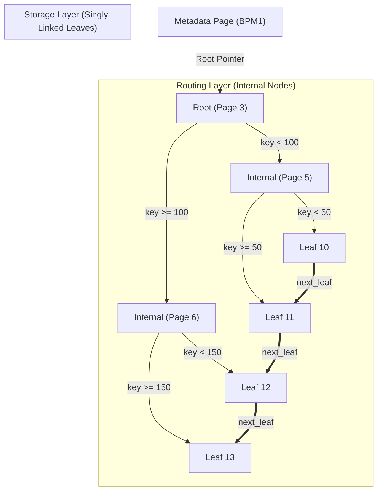
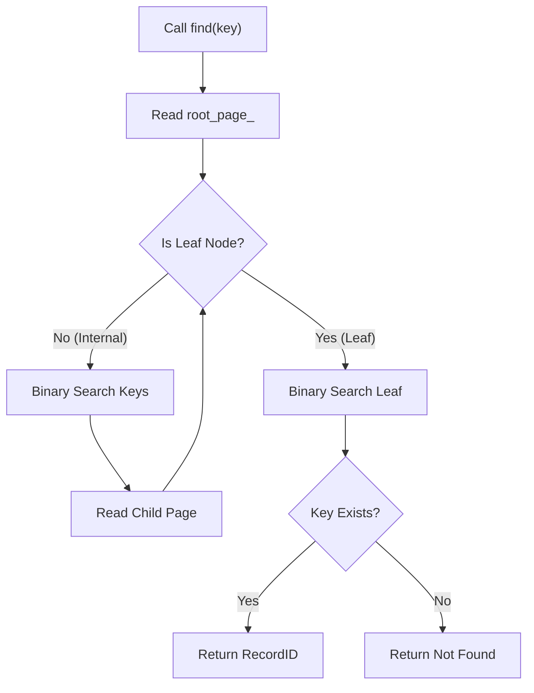
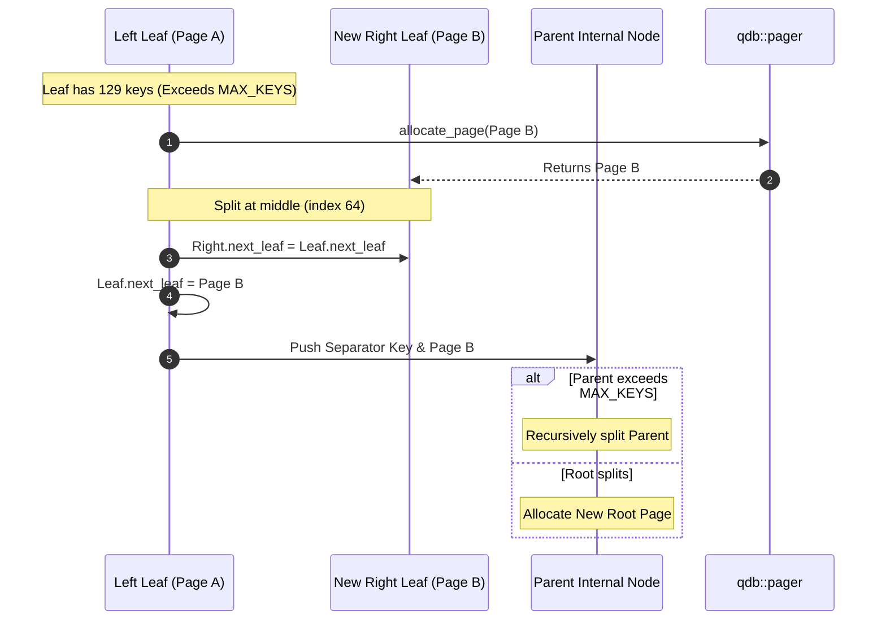

# Disk-Backed B+ Tree Index 🌲

> [!TIP] Canonical Indexing Concept
> Explore the live interactive B+ Tree simulator and node-splitting canvas at [Disk-Backed B+ Tree Indexing](/concepts/indexing).

QuartzDB implements an on-disk, self-balancing **B+ Tree Index** (`include/index/bplus_tree.hpp`, `src/index/bplus_tree.cpp`).

Every node in the tree is persisted directly into a dedicated **4096-byte database page**.

---

## Complete B+ Tree Topology

The tree separates metadata tracking, internal routing nodes, and data-pointing leaf pages:

- **Horizontal Leaf Chaining (`next_leaf`)**: All leaf pages form a singly-linked list, allowing fast range scans (`BETWEEN X AND Y`) without backtracking to internal nodes.
- **Deep Branching Factor**: With `MAX_KEYS = 128`, a 3-level tree indexes up to **$128^3 \approx 2,097,152$ records** with at most 3 disk page reads!

---

## Interactive B+ Tree Visualizer & Simulator

Type integer keys below (e.g. `10`, `25`, `50`, `120`) to watch the B+ Tree visually insert keys, balance, split at node capacity, promote separator keys to the parent, and chain leaves horizontally:

<BTreeVisualizer />

---

## Leaf Node Spatial Memory Map

Leaf nodes store primary key values paired directly with their physical `RecordID`:

<MemoryMap
  title="B+ Tree Leaf Node (4096-Byte Page)"
  subheader="PageID: 10 · Node Type: LEAF (1) · Fixed 4KB Block"
  :totalBytes="4096"
  :showGrowthSidebar="false"
  footerNote="18-byte leaf entries are packed contiguously in sorted order. Leaves link horizontally via next_leaf."
  :segments="[
    { id: 'hdr', kind: 'header', bytes: 24, label: 'Node Header (24B)', sublabel: 'BPT1 (0x31545042) · version (1) · type: LEAF · key_count · next_leaf PageID' },
    { id: 'entries', kind: 'slot', bytes: 2304, label: 'Leaf Entries Array (128 × 18B = 2,304B)', sublabel: 'Sorted tuples: { int64_t key (8B), PageID page_id (8B), uint16_t slot_index (2B) }' },
    { id: 'free', kind: 'free', bytes: 1768, label: 'Unused Page Capacity (1,768B)', sublabel: 'Available expansion space up to 4096-byte block boundary' }
  ]"
/>

---

## Internal Routing Node Spatial Memory Map

Internal nodes store separator keys and child page pointers to direct tree searches:

<MemoryMap
  title="B+ Tree Internal Node (4096-Byte Page)"
  subheader="PageID: 5 · Node Type: INTERNAL (2) · Fixed 4KB Block"
  :totalBytes="4096"
  :showGrowthSidebar="false"
  footerNote="Internal nodes maintain fan-out with child pointers (PageID) interleaved with separator keys."
  :segments="[
    { id: 'hdr', kind: 'header', bytes: 24, label: 'Node Header (24B)', sublabel: 'BPT1 · version (1) · type: INTERNAL · key_count · next_leaf: NO_PAGE' },
    { id: 'first_child', kind: 'slot', bytes: 8, label: 'First Child Pointer (8B)', sublabel: 'PageID child_0 (leftmost subtree)' },
    { id: 'pairs', kind: 'slot', bytes: 2048, label: 'Separator Pairs (128 × 16B = 2,048B)', sublabel: 'Array of { int64_t separator_key (8B), PageID child_page_id (8B) }' },
    { id: 'free', kind: 'free', bytes: 2016, label: 'Unused Page Capacity (2,016B)', sublabel: 'Available capacity up to 4096 bytes' }
  ]"
/>

---

## Point Lookup Traversal (`find`)

When searching for a primary key (e.g. `WHERE id = 75`), traversal runs in $O(\log N)$:

---

## Node Splitting & Promotion (`InsertResult`)

When inserting a key into a node that exceeds `MAX_KEYS = 128`:

---

## Underflow Rebalancing (`EraseResult`)

When a key is deleted via `BplusTree::erase(key)` and occupancy drops below `MIN_KEYS = 64`:
1. **Borrow from Sibling**: If a neighboring node has more than `MIN_KEYS` entries, borrow one entry and adjust the parent separator key.
2. **Node Merge**: If neighboring siblings are also at `MIN_KEYS`, merge the node into its sibling and free the empty page through `pager::deallocate_page()`.
3. **Root Collapse**: When the root internal node is reduced to 0 keys with a single child, the child becomes the new root, decreasing tree height by 1.
