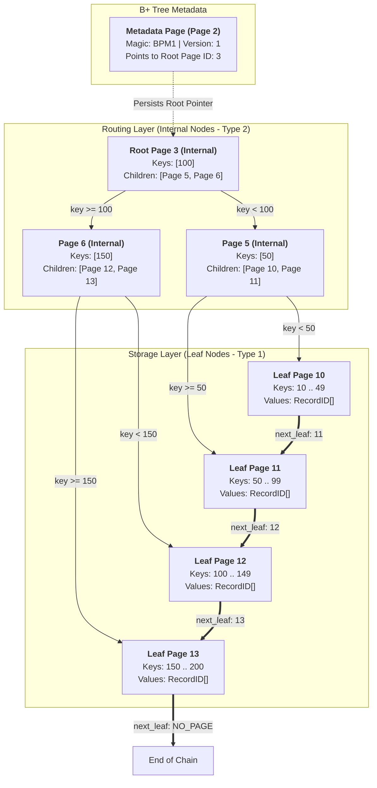
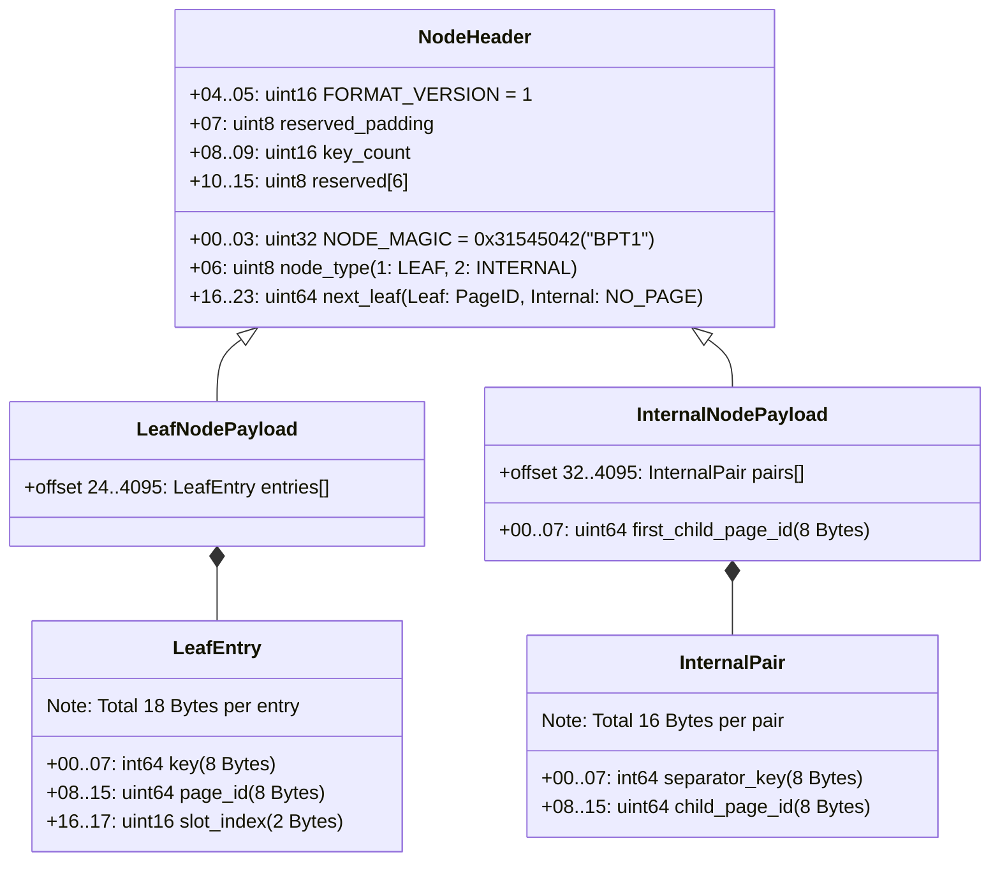
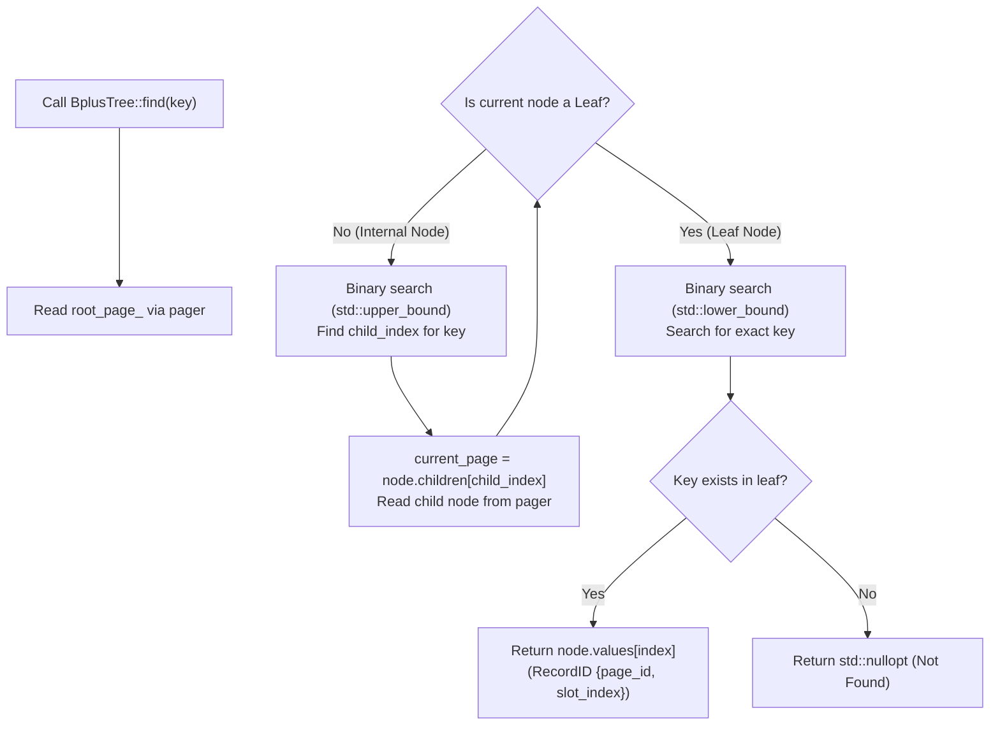
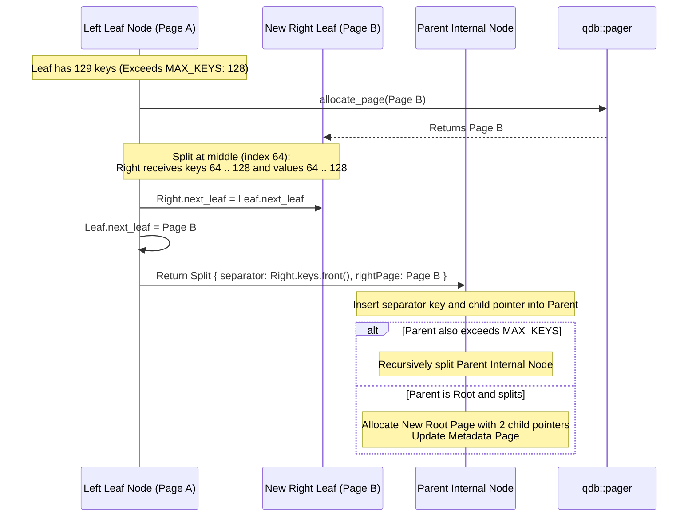

# Disk-Backed B+ Tree Index 🌲

QuartzDB implements an on-disk, self-balancing **B+ Tree Index** (`include/index/bplus_tree.hpp`, `src/index/bplus_tree.cpp`).

Every node in the tree is persisted directly into a dedicated **4096-byte database page**.

---

## Complete B+ Tree Topology

The tree separates metadata tracking, internal routing nodes, and data-pointing leaf pages:

- **Horizontal Leaf Chaining (`next_leaf`)**: All leaf pages form a singly-linked list, allowing fast range scans (`BETWEEN X AND Y`) without backtracking to internal nodes.
- **Deep Branching Factor**: With `MAX_KEYS = 128`, a 3-level tree indexes up to **$128^3 \approx 2,097,152$ records** with at most 3 disk page reads!

---

## On-Disk Node Binary Layouts

Every B+ tree node is serialized into a single 4096-byte page with a 24-byte header:

---

## $O(\log N)$ Point Lookup Traversal (`find`)

When searching for a primary key (e.g. `WHERE id = 75`):

---

## Node Splitting & Root Promotion (`InsertResult`)

When inserting a key into a node that exceeds `MAX_KEYS = 128`:

---

## Underflow Rebalancing & Merging (`EraseResult`)

When a key is deleted via `BplusTree::erase(key)` and occupancy drops below `MIN_KEYS = 64`:
1. **Borrow from Left/Right Sibling**: If a neighboring node has more than `MIN_KEYS` entries, borrow one entry and adjust the parent separator key.
2. **Node Merge**: If neighboring siblings are also at `MIN_KEYS`, merge the node into its sibling and free the empty page through `pager::deallocate_page()`.
3. **Root Collapse**: When the root internal node is reduced to 0 keys with a single child, the child becomes the new root, decreasing tree height by 1.
