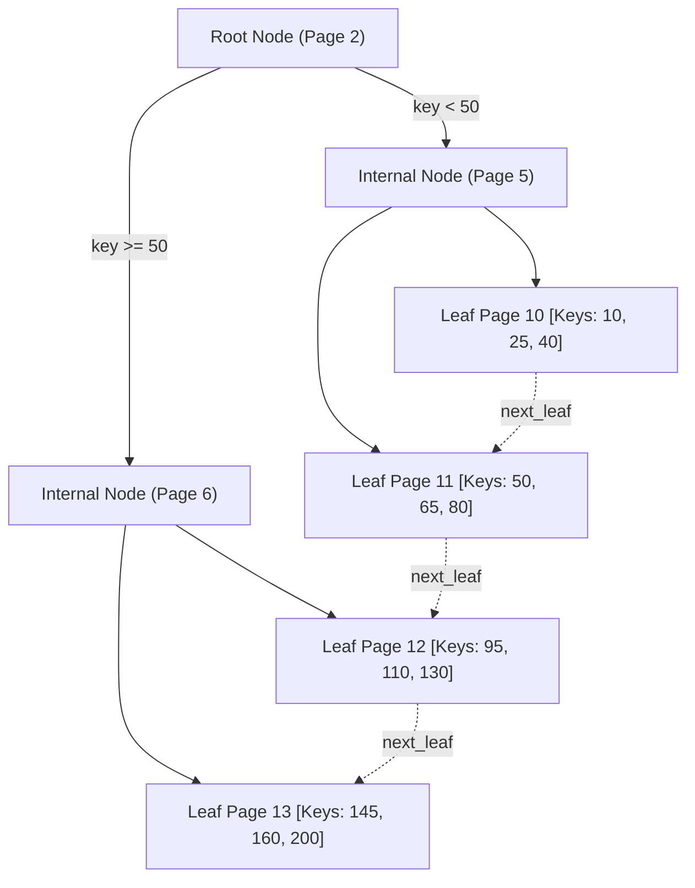

# Disk-Backed B+ Tree Index 🌲

QuartzDB features a fully persistent **B+ Tree Index** (`include/index/bplus_tree.hpp`, `src/index/bplus_tree.cpp`) designed for efficient secondary storage access.

---

## Design Principles

- **All Nodes Persist on Disk Pages**: Unlike in-memory trees (like `std::map` or AVL trees), every node (internal or leaf) occupies an independent 4KB database page allocated by the Pager.
- **High Fan-Out**: Because 4KB pages hold dozens of keys per node, the tree remains shallow (typically 2 to 3 levels even for hundreds of thousands of rows).
- **Leaf-Only Data Storage**: Record pointers (`RecordID`) are stored exclusively in leaf nodes. Internal nodes hold only indexing keys and child page pointers, maximizing branching factor.
- **Singly-Linked Leaves**: Leaf pages maintain a `next_leaf` pointer, allowing sequential range scans without traversing internal ancestor nodes.

---

## Node Structure



---

## Automatic Splitting & Root Promotion

When a leaf node exceeds capacity upon record insertion:
1. **Leaf Split**: A new sibling leaf page is allocated from the pager. The upper half of the keys and `RecordID` entries move to the new leaf.
2. **Promoting Key**: The smallest key of the new leaf is pushed into the parent internal node.
3. **Internal Node Split**: If the parent node is also at capacity, it splits recursively.
4. **Root Promotion**: When the root node splits, a new root page is allocated with pointers to the two halves, increasing the tree height by 1.

---

## Primary Index Acceleration ($O(\log N)$)

The `PrimaryIndex` class maps 64-bit primary keys directly to their physical `RecordID`:

```cpp
// O(log N) point lookup in PrimaryIndex
std::optional<RecordID> rid = primary_index.find_by_primary_key(user_id);
if (rid) {
    // Directly fetch slot from page without full table scan
    Record r = table.get_record(*rid);
}
```

In SQL execution:
```sql
-- Uses O(log N) B+ tree lookup directly:
SELECT * FROM users WHERE id = 1042;
```
As proven in our scale benchmarks, point lookups maintain **100–350 microsecond latencies** even at 120,000+ rows.
