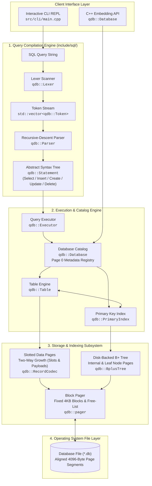

# Architecture Overview 🏗️

QuartzDB is an embedded relational database engine architected around **strict layering**, **page-oriented disk storage**, and **zero external runtime dependencies**.

Every subsystem in QuartzDB corresponds directly to concrete C++23 classes and namespaces in the codebase.

---

## Complete End-to-End System Architecture

The following diagram maps the entire pipeline from raw SQL query text down to physical 4096-byte blocks on disk:



---

## Dual Query Execution Paths

QuartzDB dynamically selects between an **$O(\log N)$ Index Fast Path** and a **Slotted-Page Table Scan** depending on the AST expression structure:

```mermaid
sequenceDiagram
    autonumber
    actor User as Client / CLI
    participant Ex as qdb::Executor
    participant Tab as qdb::Table
    participant Idx as qdb::PrimaryIndex
    participant Bpt as qdb::BplusTree
    participant Pager as qdb::pager
    participant Disk as Disk File (*.db)

    Note over User, Disk: Path A: Point Query on Primary Key (WHERE id = 42)
    User->>Ex: execute("SELECT * FROM users WHERE id = 42;")
    Ex->>Ex: Inspect AST: Filter matches Primary Key column
    Ex->>Tab: find_by_primary_key(42)
    Tab->>Idx: find_by_primary_key(42)
    Idx->>Bpt: find(42)
    Bpt->>Pager: read_node(root_page_)
    Pager->>Disk: read 4KB block
    Note over Bpt: Traverse internal nodes down to leaf page
    Bpt-->>Idx: returns RecordID { page_id: 1, slot_index: 2 }
    Idx-->>Tab: RecordID
    Tab->>Pager: read_page(page_id: 1)
    Pager->>Disk: read 4KB data page
    Note over Tab: Unpack slot 2 payload directly
    Tab-->>Ex: Record { values: [42, "Alice", "alice@example.com"] }
    Ex-->>User: Tabular result in ~100 μs

    Note over User, Disk: Path B: Filter on Non-Indexed Attribute (WHERE name = 'Bob')
    User->>Ex: execute("SELECT * FROM users WHERE name = 'Bob';")
    Ex->>Ex: Inspect AST: No index on 'name'
    Ex->>Tab: scan()
    Tab->>Pager: read_page(first_page_)
    loop For each 4KB data page in linked chain
        Pager->>Disk: read 4KB block
        Tab->>Tab: Iterate slot array (0 .. slot_count - 1)
        Tab->>Tab: RecordCodec::deserialize(slot payload)
        Tab->>Tab: Follow header.next_page pointer
    end
    Ex->>Ex: Evaluate predicate: row["name"] == 'Bob'
    Ex-->>User: Tabular filtered result
```

---

## Subsystem Responsibilities

| Subsystem | Core Files | Responsibility |
| :--- | :--- | :--- |
| **Lexer & Parser** | `sql/lexer.hpp`, `sql/parser.hpp`, `sql/ast.hpp` | Tokenizes SQL text, handles identifiers, literals, escape characters, and constructs strongly typed AST nodes. |
| **Executor** | `execution/executor.hpp` | Validates column types, determines index acceleration paths, evaluates boolean filter trees (`AND`, `OR`, `<`, `=`, `!=`), and executes relational `JOIN`s. |
| **Database & Catalog** | `quartz/database.hpp` | Maintains the in-memory registry of active `Table` instances, loads/persists metadata to **Page 0**, and manages database lifecycle. |
| **Table Manager** | `storage/table.hpp` | Manages page allocation for records, handles record insertion into slotted pages, delegates primary keys to `PrimaryIndex`, and coordinates page compaction. |
| **Primary Index** | `index/primary_index.hpp` | Coordinates with `BplusTree` to map 64-bit integer keys to `RecordID` structs and enforces unique primary key constraints on insert. |
| **B+ Tree Engine** | `index/bplus_tree.hpp` | Maintains a disk-resident, balanced multi-way tree with node splits, merges, leaf chaining, and $O(\log N)$ point lookups. |
| **Slotted Storage** | `storage/table.cpp`, `storage/record.cpp` | Encodes variable-length values via `RecordCodec` and manages slot arrays with two-way page growth. |
| **Pager** | `storage/pager.hpp` | Direct file I/O abstraction managing 4096-byte boundaries, dynamic page allocation, and page deallocation free lists. |
