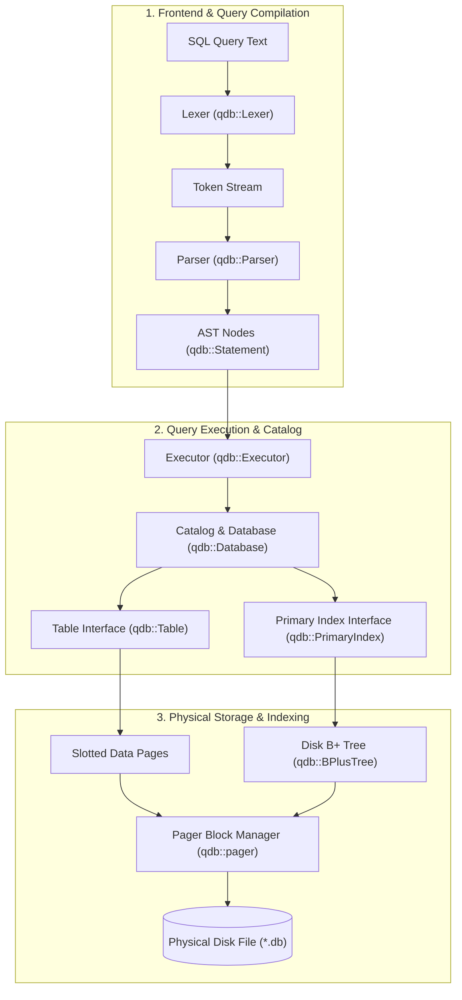

# Architecture Overview 🏗️

QuartzDB follows a classic decoupled database architecture where execution planning, storage serialization, and index management have distinct boundaries.

---

## System Decomposition

---

## Pipeline Walkthrough

### 1. Lexical Analysis (`include/sql/lexer.hpp`)
The SQL text is scanned character-by-character into tokens (`qdb::Token`). It handles:
- Case-insensitive keywords (`SELECT`, `FROM`, `WHERE`, `JOIN`, `UPDATE`, etc.)
- Identifiers and quoted strings (`'text with \'escapes\''`)
- Numeric integer literals
- Binary comparison operators (`=`, `!=`, `<`, `<=`, `>`, `>=`)
- Logical operators (`AND`, `OR`, `NOT`) and parentheses

### 2. AST Parsing (`include/sql/parser.hpp`)
A recursive-descent parser consumes tokens and produces type-safe statement ASTs:
- `CreateTableStatement`: Table name, column list, types, primary key designation.
- `SelectStatement`: Projected column names, target table, optional `JOIN` clause, and a boolean expression tree for `WHERE`.
- `InsertStatement`: Column values to serialize into a new record.
- `UpdateStatement`: Column assignment pairs and filtering predicate.
- `DeleteStatement`: Target table and deletion criteria.

### 3. Execution Engine (`include/execution/executor.hpp`)
The executor receives AST statements and:
- Validates table and column existence against `Database` catalog.
- Evaluates if a query filter can use a **B+ Tree Fast Path**: When a query predicates on an equality check of the primary key (`WHERE id = 42`), the executor bypasses a full-table scan and executes an $O(\log N)$ point lookup directly via `PrimaryIndex`.
- Otherwise performs linear scan across slotted pages with predicate evaluation.
- Evaluates relational joins (`JOIN ... ON ...`).

### 4. Catalog Management (`include/quartz/database.hpp`)
The catalog is stored at **Page 0** of the database file. On database startup:
- The pager reads Page 0.
- Schema definitions, table names, root data page IDs, and index root page IDs are decoded.
- On table creation or schema modification, the catalog is re-serialized and persisted back to Page 0.
