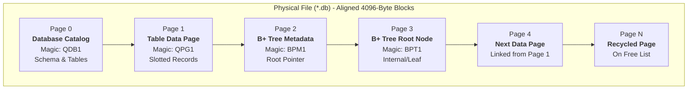
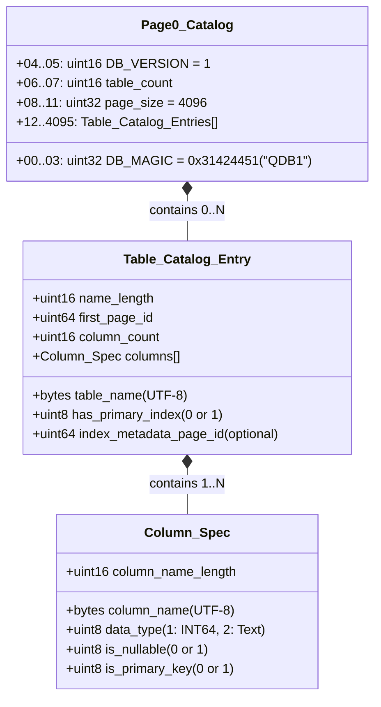
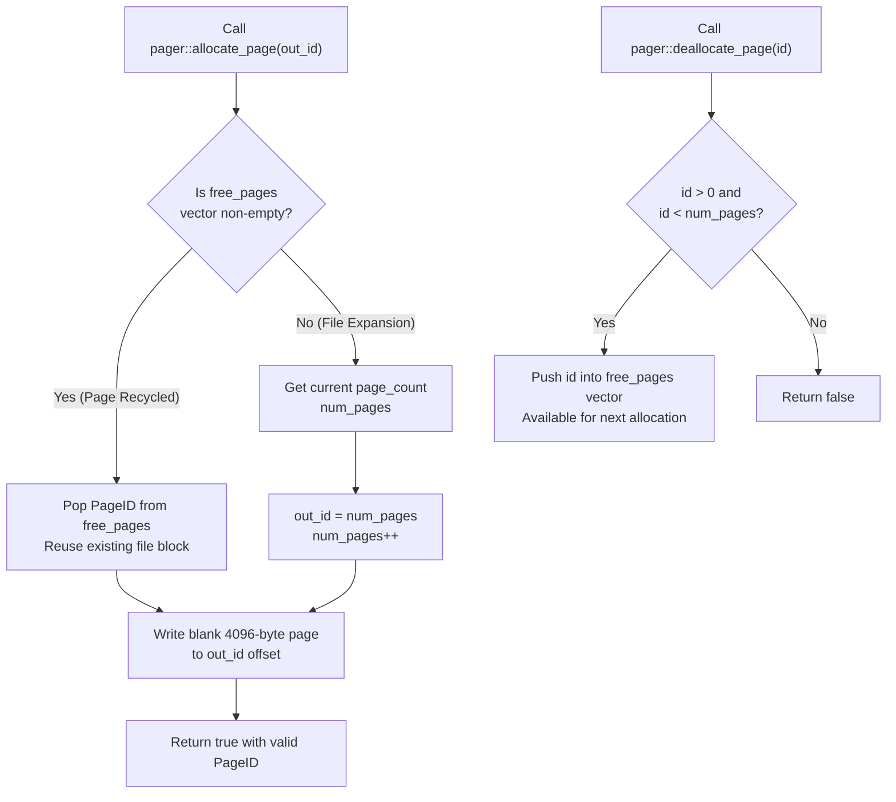

# Page & Pager Engine 📄

The **Pager** (`include/storage/pager.hpp`, `src/storage/pager.cpp`) manages the physical file layout and low-level block I/O operations for QuartzDB.

Every database in QuartzDB is stored in a single binary file divided into contiguous, uniform **4096-byte (4KB)** pages.

---

## Physical File Partitioning

The database file consists of sequential 4KB blocks addressed by a 64-bit `PageID` ($0, 1, 2, \dots$):



Every page read and write computes the exact file seek offset:
$$\text{File Offset} = \text{PageID} \times 4096$$

---

## Page 0: The Catalog Architecture

Page 0 is permanently reserved for the global database catalog. It tracks all tables, schema definitions, and root pages across database sessions:



### Binary Layout Details

```text
+-----------------------------------------------------------------------+
| BYTES 0..3   | DB_MAGIC: 0x31424451 ("QDB1" in Little-Endian)         |
| BYTES 4..5   | DB_VERSION: 1                                          |
| BYTES 6..7   | TABLE COUNT: Number of registered tables in catalog    |
| BYTES 8..11  | PAGE_SIZE: 4096 bytes                                  |
+-----------------------------------------------------------------------+
| BYTES 12..N  | Table Entry 0:                                         |
|              |   - name_length (uint16) + first_page (uint64)         |
|              |   - name bytes                                         |
|              |   - col_count (uint16) + column specs                  |
|              |   - has_index (uint8) + index_meta_page (uint64)       |
+-----------------------------------------------------------------------+
|              | Table Entry 1 ...                                      |
+-----------------------------------------------------------------------+
|              | [ UNALLOCATED FREE SPACE IN PAGE 0 ]                   |
+-----------------------------------------------------------------------+
```

---

## Page Allocation & Recycling Workflow

The pager maintains an in-memory `free_pages` list to recycle blocks freed by `DROP TABLE` or B+ tree rebalancing:



---

## Memory Safety & Block Alignment

- **Static Size Enforcement**: `static_assert(sizeof(Page) == PAGE_SIZE, "Page size is not 4096 bytes");` guarantees strict boundary alignment at compile time.
- **Zero In-Memory Buffering Spills**: Full 4KB `std::array<std::byte, 4096>` structs prevent buffer overruns and align with standard CPU cache line and OS memory page architectures.
