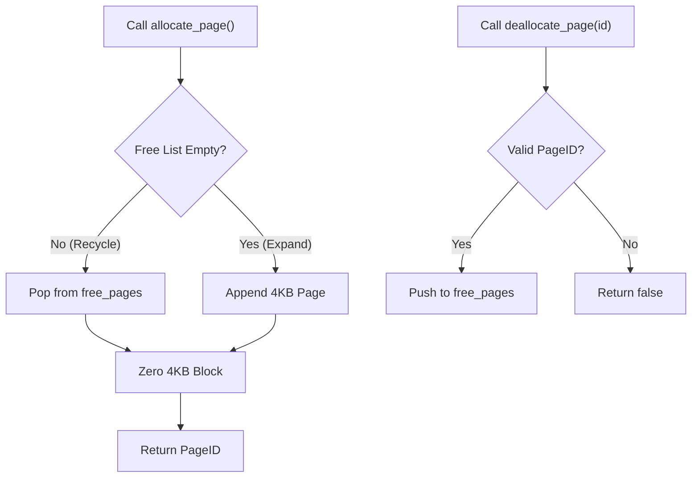

# Page & Pager Engine 📄

The **Pager** (`include/storage/pager.hpp`, `src/storage/pager.cpp`) manages the physical file layout and low-level block I/O operations for QuartzDB.

Every database in QuartzDB is stored in a single binary file divided into contiguous, uniform **4096-byte (4KB)** pages.

---

## Physical File Partitioning

The database file consists of sequential 4KB blocks addressed by a 64-bit `PageID` ($0, 1, 2, \dots$):

Every page read and write computes the exact file seek offset:
$$\text{File Offset} = \text{PageID} \times 4096$$

---

## Page 0: The Catalog Spatial Map

Page 0 is permanently reserved for the global database catalog. It tracks all registered tables, column schema definitions, and root pages across database sessions:

<MemoryMap
  title="Page 0 Database Catalog (4096-Byte Page)"
  subheader="PageID: 0 · Permanent Metadata Root"
  :totalBytes="4096"
  :showGrowthSidebar="false"
  footerNote="Page 0 mounts on startup. If DB_MAGIC equals 0x31424451 (QDB1), the engine loads table schemas without full scans."
  :segments="[
    { id: 'hdr', kind: 'header', bytes: 12, label: 'Catalog Header (12B)', sublabel: 'QDB1 (0x31424451) · DB_VERSION (1) · table_count · page_size (4096)' },
    { id: 'entries', kind: 'slot', bytes: 512, label: 'Table Catalog Entries (~512B)', sublabel: 'Serialized table descriptors: name, first_page, column schemas, index_metadata_page' },
    { id: 'free', kind: 'free', bytes: 3572, label: 'Unallocated Free Space (3,572B)', sublabel: 'Available for additional table schema registrations' }
  ]"
/>

---

## Page Allocation & Recycling Workflow

The pager maintains an in-memory `free_pages` list to recycle blocks freed by `DROP TABLE` or B+ tree rebalancing:

---

## Memory Safety & Block Alignment

- **Static Size Enforcement**: `static_assert(sizeof(Page) == PAGE_SIZE, "Page size is not 4096 bytes");` guarantees strict boundary alignment at compile time.
- **Zero In-Memory Buffering Spills**: Full 4KB `std::array<std::byte, 4096>` structs prevent buffer overruns and align with standard CPU cache line and OS memory page architectures.
