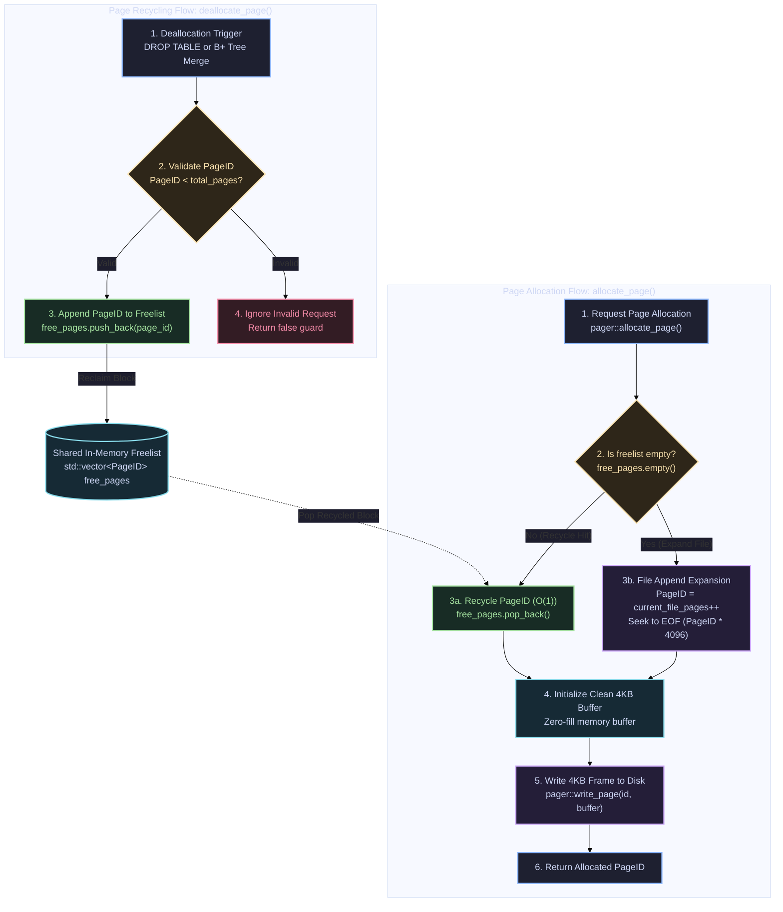

# Page & Pager Engine 📄

The **Pager** (`include/storage/pager.hpp`, `src/storage/pager.cpp`) manages physical file layout, uniform block partitioning, and low-level block I/O operations for QuartzDB.

Every database in QuartzDB persists within a single binary file strictly divided into contiguous, uniform **4096-byte (4KB)** pages.

---

## Physical File Partitioning

The database file consists of sequential 4KB blocks addressed by a 64-bit `PageID` ($0, 1, 2, \dots$):

```mermaid
%%{init: {'theme': 'base', 'themeVariables': {'edgeLabelBackground': '#1e1e2e', 'tertiaryTextColor': '#cdd6f4'}}}%%
flowchart LR
    classDef entry fill:#1e2030,stroke:#89b4fa,stroke-width:2px,color:#cdd6f4;
    classDef guard fill:#2e2619,stroke:#f9e2af,stroke-width:2px,color:#f9e2af;
    classDef success fill:#182c25,stroke:#a6e3a1,stroke-width:2px,color:#a6e3a1;
    classDef error fill:#331c24,stroke:#f38ba8,stroke-width:2px,color:#f38ba8;
    classDef disk fill:#241e38,stroke:#cba6f7,stroke-width:2px,color:#cdd6f4;
    classDef shared fill:#162a35,stroke:#89dceb,stroke-width:2px,color:#cdd6f4;

    subgraph FileStore ["Physical Database File Layout (Fixed 4,096-Byte Blocks)"]
        direction TB

        subgraph BlockRow1 ["Base Allocations (Pages 0 - 2)"]
            direction LR
            P0["Page 0: System Catalog<br/>Offset: 0x0000 - 0x0FFF (4KB)<br/>Magic: 0x31424451 (QDB1)<br/>Tables registry &amp; Schema root"]:::entry
            P1["Page 1: Table Data Root<br/>Offset: 0x1000 - 0x1FFF (4KB)<br/>Magic: 0x31475051 (QPG1)<br/>First Slotted-Page of Table A"]:::disk
            P2["Page 2: B+ Tree Meta<br/>Offset: 0x2000 - 0x2FFF (4KB)<br/>Magic: 0x314D5042 (BPM1)<br/>Index root pointer &amp; fan-out"]:::shared
        end

        subgraph BlockRow2 ["Index & Data Expansion (Pages 3 - 5)"]
            direction LR
            P3["Page 3: B+ Tree Root Node<br/>Offset: 0x3000 - 0x3FFF (4KB)<br/>Magic: 0x31545042 (BPT1)<br/>Routing keys &amp; child pointers"]:::shared
            P4["Page 4: Next Table Page<br/>Offset: 0x4000 - 0x4FFF (4KB)<br/>Linked via next_page from Page 1<br/>Slotted records &amp; compaction"]:::disk
            P5["Page 5: B+ Tree Leaf Node<br/>Offset: 0x5000 - 0x5FFF (4KB)<br/>Sorted {key, RecordID} pairs<br/>Chained via next_leaf"]:::success
        end

        subgraph BlockRow3 ["Freelist Recycling Pool (Pages 6+)"]
            direction LR
            P6["Page 6: Recycled Page<br/>Offset: 0x6000 - 0x6FFF (4KB)<br/>Status: IN FREELIST<br/>Ready for instant zero-cost reuse"]:::guard
            PN["Page N: File Extension<br/>Offset: N * 4096 Bytes<br/>Dynamically appended on demand"]:::disk
        end

        P0 --> P1 --> P2
        P2 --> P3 --> P4 --> P5
        P5 -.-> P6 -.-> PN
    end
```

Every page read and write calculates the physical file seek offset directly:
$$\text{File Seek Offset} = \text{PageID} \times 4096$$

---

## Page 0: The Catalog Spatial Map

Page 0 is permanently reserved for the global database catalog. It tracks all registered tables, column schema definitions, and root pages across database sessions:

<MemoryMap
  title="Page 0 Database Catalog (4096-Byte Page)"
  subheader="PageID: 0 · Permanent Metadata Root"
  :totalBytes="4096"
  :showGrowthSidebar="false"
  footerNote="Page 0 mounts on startup. If DB_MAGIC equals 0x31424451 (QDB1), the engine loads table schemas without full scans."
  :segments="[
    { id: 'hdr', kind: 'header', bytes: 12, label: 'Catalog Header (12B)', sublabel: 'QDB1 (0x31424451) · DB_VERSION (1) · table_count · page_size (4096)' },
    { id: 'entries', kind: 'slot', bytes: 512, label: 'Table Catalog Entries (~512B)', sublabel: 'Serialized table descriptors: name, first_page, column schemas, index_metadata_page' },
    { id: 'free', kind: 'free', bytes: 3572, label: 'Unallocated Free Space (3,572B)', sublabel: 'Available for additional table schema registrations' }
  ]"
/>

---

## Page Allocation & Recycling Workflow

The pager maintains an in-memory `free_pages` list (`std::vector<PageID>`) to recycle blocks deallocated by `DROP TABLE` or B+ tree underflow merges, eliminating disk fragmentation and avoiding unnecessary file size inflation:

---

## Memory Safety & Block Alignment

- **Static Boundary Enforcement**: Compile-time assertion `static_assert(sizeof(Page) == PAGE_SIZE, "Page size is not 4096 bytes");` guarantees strict 4KB alignment.
- **Direct Sector I/O**: Reads and writes align directly with OS virtual memory pages and hardware physical disk sectors.
- **Zero In-Memory Buffering Spills**: Fixed-size `std::array<std::byte, 4096>` memory buffers prevent memory corruption, buffer overflows, and segmentation faults.
