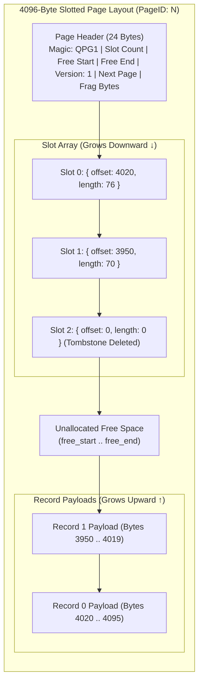
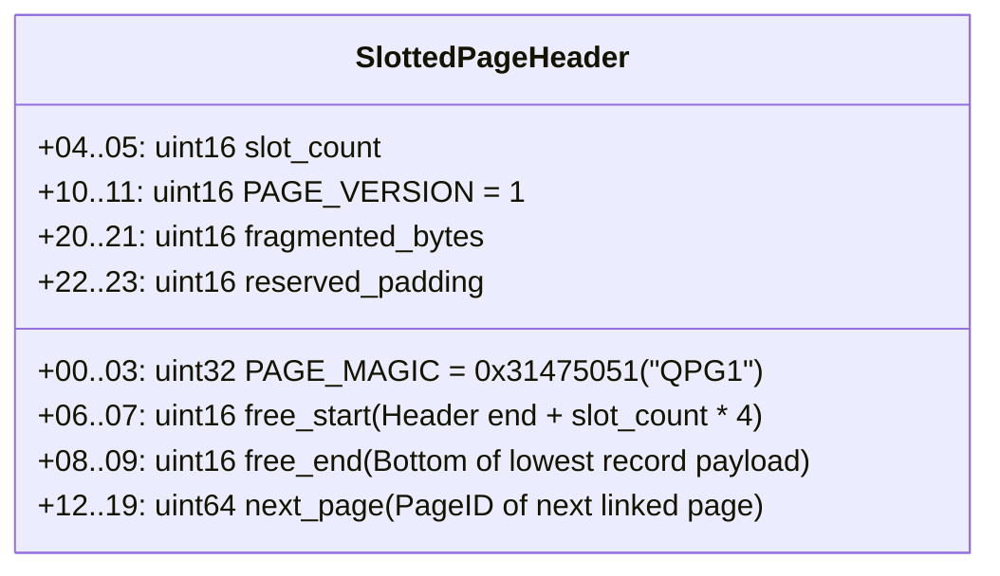
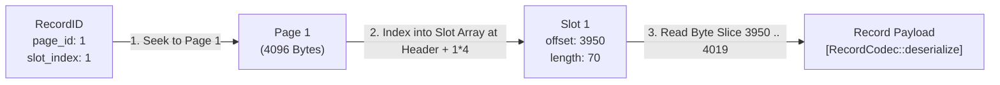
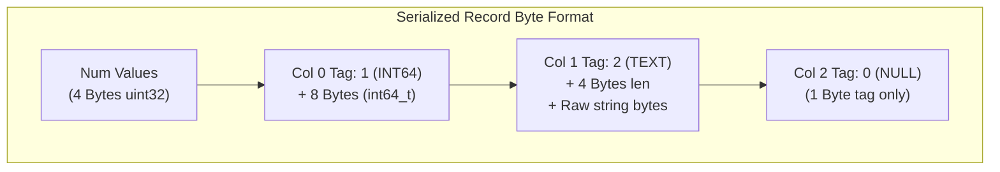
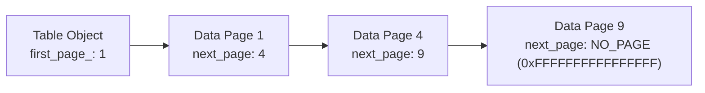

# Slotted-Page Storage 📦

QuartzDB uses the **Slotted-Page Architecture** (`include/storage/table.hpp`, `src/storage/table.cpp`) for storing records within 4096-byte data pages.

---

## Slotted-Page Memory Anatomy

Each data page uses a **two-way growth layout**:
1. **Header & Slot Array**: Grow **forward** (top-down) starting at offset 0.
2. **Record Payloads**: Grow **backward** (bottom-up) starting at byte 4096.



---

## Page Header Specification (24 Bytes)

The header occupies the first 24 bytes of every table data page:



- **`free_start`**: Offset where the next slot entry can be written. Initialized to `24`.
- **`free_end`**: Offset where the next record payload can be placed. Initialized to `4096`.
- **`fragmented_bytes`**: Accumulates unusable gap bytes created when records are deleted or updated with smaller payloads.

---

## Slot Array & RecordID Indirection

In QuartzDB, records are never referenced by raw byte offsets. Instead, they are referenced by a persistent **`RecordID`**:



### Why Logical Indirection Matters
When a page is defragmented (compacted), records are moved to new byte offsets. However, **the slot index remains unchanged**. As a result, B+ Tree index pointers (`RecordID`) remain permanently valid without needing re-indexing!

---

## Record Binary Serialization (`RecordCodec`)

Records are serialized into compact byte vectors with typed tag discriminators:



| Tag ID | C++ Type | Byte Size | Serialization Scheme |
| :--- | :--- | :--- | :--- |
| `0` (`NULL_TAG`) | `std::monostate` | 1 byte | Single tag byte |
| `1` (`INTEGER_TAG`) | `std::int64_t` | 9 bytes | 1 byte tag + 8 bytes little-endian integer |
| `2` (`TEXT_TAG`) | `std::string` | $5 + L$ bytes | 1 byte tag + 4 bytes length ($L$) + UTF-8 string bytes |

---

## Linked List Table Chain

When a page fills up (`free_start + 4 > free_end - record_size`), a new page is allocated and linked via `next_page`:



---

## Page Compaction Algorithm (`compact_page`)

When updates or deletions leave fragmentation (`fragmented_bytes > 0`), the engine rebuilds the page cleanly:

```mermaid
sequenceDiagram
    participant P as Fragmented Page
    participant R as Rebuilt Page Buffer
    participant H as PageHeader

    Note over P: Slots 0 and 2 active; Slot 1 deleted (length: 0). Free space split by gaps.
    P->>R: initialize_page(R)
    P->>R: Copy slot_count and next_page
    loop For each active slot i (0 .. slot_count - 1)
        alt record_length == 0
            Note over R: Write empty slot tombstone {0, 0}
        else record_length > 0
            Note over R: Decrement new_free_end by record_length
            P->>R: Copy bytes from old offset to new_free_end
            R->>R: Update Slot[i] with new_free_end and length
        end
    end
    R->>H: Set free_end = new_free_end, fragmented_bytes = 0
    Note over P: Page now fully compacted with 0 fragmented bytes
```
