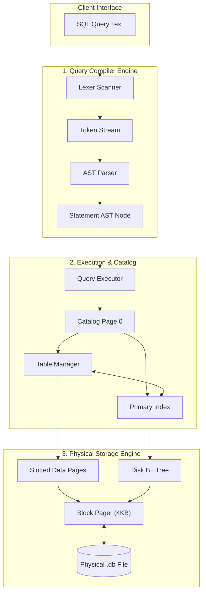

# Engine Architecture & Query Pipeline 🏛️

QuartzDB decouples query compilation, catalog management, and physical disk storage into four explicit layers.

---

## The Query Pipeline

---

## Layer Responsibilities

### 1. Lexical Scanner (`sql/lexer.hpp`)
Scans SQL character streams into strongly-typed `qdb::Token` structures. Handles keywords (`SELECT`, `INSERT`, `WHERE`, `JOIN`), string literals with escapes (`'Alice\'s Book'`), numbers, and comparison operators.

### 2. AST Parser (`sql/parser.hpp`)
Recursive-descent grammar compiler generating statement variants (`CreateTableStatement`, `SelectStatement`, `InsertStatement`, `UpdateStatement`, `DeleteStatement`) with boolean predicate AST expression trees.

### 3. Execution Engine (`execution/executor.hpp`)
Evaluates plan trees. Inspects AST clauses to route primary-key point lookups (`WHERE id = ?`) to the **$O(\log N)$ B+ Tree fast-path** or falls back to linear slotted-page scans with filter evaluation.

### 4. Pager Block Manager (`storage/pager.hpp`)
Maintains 4096-byte boundaries, block seek offsets ($PageID \times 4096$), dynamic file expansion, and free-list page recycling.
