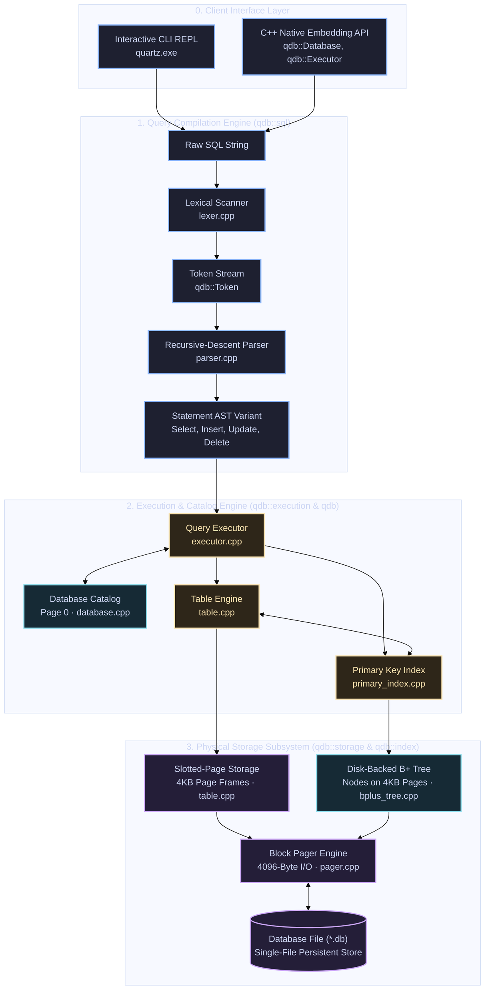

# Engine Architecture & Query Pipeline 🏛️

QuartzDB decouples query compilation, catalog management, and physical disk storage into four explicit architectural layers. Every subsystem corresponds directly to concrete C++23 classes and namespaces in the codebase.

---

## Complete Multi-Layer Architecture Diagram

The system architecture cleanly separates query processing, catalog coordination, and on-disk block serialization:

---

## End-to-End Query Execution Pipeline

The lifecycle of an SQL query through QuartzDB follows an explicit 6-phase pipeline:

```mermaid
%%{init: {'theme': 'base', 'themeVariables': {'edgeLabelBackground': '#1e1e2e', 'tertiaryTextColor': '#cdd6f4'}}}%%
flowchart LR
    classDef entry fill:#1e2030,stroke:#89b4fa,stroke-width:2px,color:#cdd6f4;
    classDef guard fill:#2e2619,stroke:#f9e2af,stroke-width:2px,color:#f9e2af;
    classDef success fill:#182c25,stroke:#a6e3a1,stroke-width:2px,color:#a6e3a1;
    classDef error fill:#331c24,stroke:#f38ba8,stroke-width:2px,color:#f38ba8;
    classDef disk fill:#241e38,stroke:#cba6f7,stroke-width:2px,color:#cdd6f4;
    classDef shared fill:#162a35,stroke:#89dceb,stroke-width:2px,color:#cdd6f4;

    Q1["1. Raw SQL Query<br/>SELECT * FROM users..."]:::entry
    Q2["2. Lexical Scan<br/>Keyword, Ident, Literal Tokens"]:::entry
    Q3["3. AST Construction<br/>Expression Trees &amp; Clauses"]:::guard
    Q4["4. Planning &amp; Routing<br/>PK Fast-Path vs Full Scan"]:::guard
    Q5["5. Physical Execution<br/>INLJ, B+ Tree, Slotted Page"]:::disk
    Q6["6. QueryResult<br/>Tabular Rows &amp; Affected Counts"]:::success

    Q1 --> Q2 --> Q3 --> Q4 --> Q5 --> Q6
```

### Detailed Pipeline Stages

<PipelineStages />

---

## Architectural Layer Responsibilities

### 1. Lexical Scanner (`include/sql/lexer.hpp`, `src/sql/lexer.cpp`)
- Scans SQL character streams into strongly-typed `qdb::Token` structures.
- Detects keywords (`SELECT`, `INSERT`, `UPDATE`, `DELETE`, `CREATE`, `DROP`, `JOIN`, `LEFT`, `ON`, `WHERE`, `ORDER`, `BY`, `LIMIT`, `OFFSET`, `COUNT`, `SUM`, `AVG`, `MIN`, `MAX`).
- Handles complex string literal escaping (`'O\'Reilly'`, `''`, `\n`, `\t`).
- Emits typed literals for signed 64-bit integers and comparison operators (`=`, `!=`, `<`, `<=`, `>`, `>=`).

### 2. AST Parser (`include/sql/parser.hpp`, `src/sql/parser.cpp`)
- Hand-written recursive-descent grammar compiler generating type-safe `qdb::sql::Statement` variants.
- Parses boolean expression trees with explicit operator precedence (`NOT` > `AND` > `OR`).
- Parses projections, wildcard expansions (`*`, `table.*`), join specifications, aggregate function calls, order directions (`ASC`, `DESC`), and pagination limits.

### 3. Execution Engine (`include/execution/executor.hpp`, `src/execution/executor.cpp`)
- Evaluates statements against the database catalog:
  - **Single Point Lookups**: When filtering on equality against the primary key, routes directly to the $O(\log N)$ B+ Tree fast-path.
  - **Index Nested-Loop Join (INLJ)**: Resolves relational joins against indexed primary keys in $O(N \log M)$ time.
  - **Aggregate Engine**: Evaluates `COUNT`, `SUM`, `AVG`, `MIN`, `MAX` with automatic type validation and `NULL` semantics.
  - **In-Memory Sort & Windowing**: Applies `std::stable_sort` on typed variants and performs zero-copy `LIMIT`/`OFFSET` slicing.

### 4. Slotted-Page Table Manager (`include/storage/table.hpp`, `src/storage/table.cpp`)
- Packs dynamic tuples into fixed 4096-byte blocks using the slotted-page format:
  - Slot directory grows **downward** from offset 24.
  - Variable-length record payloads grow **upward** from offset 4096.
- Addresses records via stable 64-bit `RecordID` (`{PageID, slot_index}`).
- In-memory `compact_page()` eliminates internal fragmentation without invalidating external B+ tree index pointers.

### 5. Disk-Backed B+ Tree Index (`include/index/bplus_tree.hpp`, `src/index/bplus_tree.cpp`)
- Fully persistent balanced tree where every root, internal routing, and leaf node occupies a dedicated 4KB database page.
- Balances automatically upon insertions: splits nodes when `keys > 128`, promotes separator keys to internal parent nodes, and chains leaf pages horizontally via `next_leaf`.
- Handles deletions via underflow detection, borrowing from adjacent siblings, or merging nodes and collapsing roots.

### 6. Block Pager & Catalog (`include/storage/pager.hpp`, `src/storage/pager.cpp`, `src/quartz/database.cpp`)
- Performs direct 4096-byte page reads and writes at byte offset $\text{PageID} \times 4096$.
- Manages dynamic file expansion and tracks recycled blocks via an in-memory `free_pages` list.
- Permanently reserves **Page 0** for the database catalog (`DB_MAGIC = 0x31424451`), enabling instant mounting of table schemas and root pointers across restarts.
