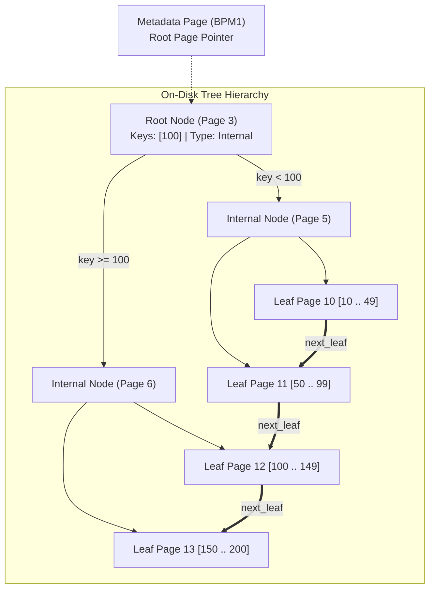

# Disk-Backed B+ Tree Indexing 🌲

QuartzDB implements an on-disk, self-balancing **B+ Tree Index** (`include/index/bplus_tree.hpp`). Every node occupies an independent 4096-byte database page.

---

## Topology & Node Fan-Out

- **Fan-Out (`MAX_KEYS = 128`)**: A 3-level tree indexes over 2 million records with only 3 disk page reads.
- **Horizontal Leaf Chaining (`next_leaf`)**: Singly-linked leaf nodes enable sequential range scans without navigating ancestor internal pages.
- **Point Lookups ($O(\log N)$)**: Point queries on primary keys execute in sub-millisecond latencies (~100–350 μs) across 120,000+ records.
