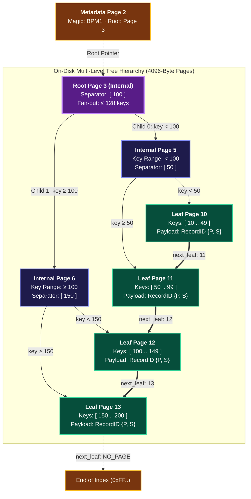

# Disk-Backed B+ Tree Indexing 🌲

QuartzDB implements an on-disk, self-balancing **B+ Tree Index** (`include/index/bplus_tree.hpp`). Every node occupies an independent 4096-byte database page.

---

## Interactive B+ Tree Visualizer & Simulator

Type integer keys below (e.g. `10`, `25`, `50`, `120`) to watch the B+ Tree visually insert keys, balance, split at node capacity, promote separator keys to the parent, and chain leaves horizontally:

<BTreeVisualizer />

---

## Topology & Node Fan-Out

- **Fan-Out (`MAX_KEYS = 128`)**: A 3-level tree indexes over 2 million records with only 3 disk page reads.
- **Horizontal Leaf Chaining (`next_leaf`)**: Singly-linked leaf nodes enable sequential range scans without navigating ancestor internal pages.
- **Point Lookups ($O(\log N)$)**: Point queries on primary keys execute in sub-millisecond latencies (~100–350 μs) across 120,000+ records.

---

## Leaf Node Spatial Layout

<MemoryMap
  title="B+ Tree Leaf Node (4096-Byte Page)"
  subheader="PageID: 10 · Node Type: LEAF (1) · Fixed 4KB Block"
  :totalBytes="4096"
  :showGrowthSidebar="false"
  footerNote="Leaf entries are packed contiguously in sorted order. Leaves link horizontally via next_leaf."
  :segments="[
    { id: 'hdr', kind: 'header', bytes: 24, label: 'Node Header (24B)', sublabel: 'BPT1 · version 1 · type: LEAF · key_count · next_leaf' },
    { id: 'entries', kind: 'slot', bytes: 2304, label: 'Leaf Entries (128 × 18B = 2,304B)', sublabel: 'Sorted pairs: { key (8B), RecordID {page_id, slot} (10B) }' },
    { id: 'free', kind: 'free', bytes: 1768, label: 'Unused Capacity (1,768B)', sublabel: 'Available expansion space' }
  ]"
/>
