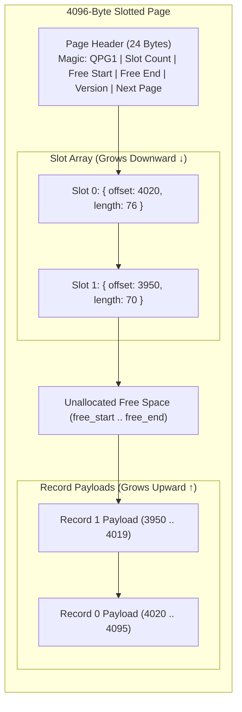

# Slotted-Page Storage & Pager 📦

QuartzDB uses the **Slotted-Page Architecture** inside fixed 4096-byte blocks to prevent external fragmentation from variable-length text records.

---

## 4KB Slotted-Page Memory Layout

Each data page utilizes a two-way growth pattern:



---

## The RecordID Pointer

Records are addressed by a stable logical tuple:

```cpp
struct RecordID {
    PageID   page_id;     // 64-bit ID of the 4KB data page
    uint16_t slot_index;  // Index into the page's slot array
};
```

Because B+ tree leaf nodes reference `RecordID` rather than physical byte offsets, pages can defragment and relocate records via `compact_page()` without breaking index pointers.
