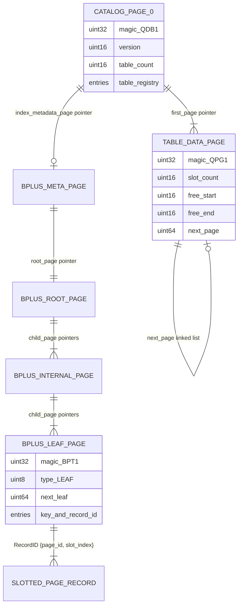

# Relational Diagrams & Interactive ERD 🗺️

This section provides visual entity-relationship diagrams (ERD) mapping the relational models and foreign key chains in QuartzDB.

---

## Interactive Relational ERD

Click on any table or hover to isolate relationships, primary keys 🔑, and foreign key pointers 🔗:

<InteractiveErd />

---

## Physical Page Layout ERD

Below is the low-level physical layout demonstrating how tables link into slotted pages and B+ trees across 4096-byte database blocks:

