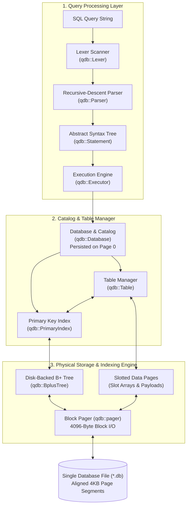

# What is QuartzDB? 💎

**QuartzDB** is a lightweight, embedded relational database engine written from scratch in modern **C++23**. 

It is designed with two core objectives:
1. **Architectural Clarity & Educational Rigor**: Clean, self-contained implementations of fundamental database concepts: slotted-page file layouts, disk-based B+ tree indexes, and a recursive-descent SQL compiler without external monolithic libraries.
2. **Practical Performance & Safety**: Strict schema enforcement, sub-millisecond point queries, and consistent throughput sustained over 120,000+ records.

---

## High-Level System Architecture

QuartzDB is structured into clear abstraction layers separating query evaluation from physical disk serialization:

---

## Key Highlights

- **Embedded Engine**: Runs directly within your process. No background daemons, socket overhead, or network latency.
- **Single File Storage**: All catalog definitions, table data, and B+ tree index nodes persist in a unified `.db` file.
- **Slotted-Page Architecture**: Fixed 4KB pages manage variable-length string payloads and avoid external fragmentation.
- **Disk-Backed B+ Tree Indexing**: Maintains an on-disk balanced tree that maps 64-bit integer keys to physical `RecordID` tuples (`{PageID, slot_index}`) for $O(\log N)$ point lookups.
- **Native SQL Engine**: Supports `CREATE TABLE`, `DROP TABLE`, `INSERT`, `SELECT` (projections, complex `WHERE` boolean clauses, relational `JOIN`), `UPDATE`, and `DELETE`.
- **Interactive REPL (`quartz.exe`)**: A terminal shell equipped with tabular ASCII output, query accumulation, catalog exploration (`.schema`, `.tables`), and multi-database switching (`USE <db>`, `CREATE DATABASE <db>`).
