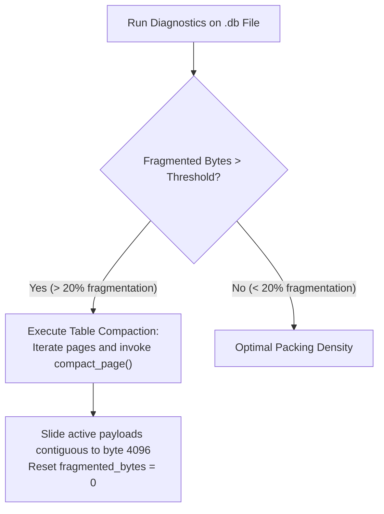

# Operations & Compaction Runbooks ⚙️

Operational procedures for administering, backing up, compacting, and maintaining QuartzDB database files in production.

---

## 1. Backup Procedures

Because QuartzDB stores all tables, catalog definitions, and B+ tree index nodes in a **single `.db` file**, backups are simple and robust.

### 1.1 Cold / Offline Backups
If the application process can be momentarily stopped:
```bash
# 1. Stop host application service
systemctl stop my_service

# 2. Copy the database file
cp /var/data/quartz/prod_orders.db /backup/quartz/prod_orders_$(date +%Y%m%d).db

# 3. Restart host application service
systemctl start my_service
```

### 1.2 Snapshotting with Lock
For 24/7 workloads, perform atomic file-system volume snapshots (e.g., LVM snapshot, ZFS snapshot, or AWS EBS volume snapshot).

---

## 2. Storage Compaction Runbook

When records are updated or deleted, slotted pages accumulate `fragmented_bytes`. While QuartzDB automatically compacts individual pages during insertions when space is tight, administrators can also review page efficiency:



### Compaction Mechanics
Inside `src/storage/table.cpp`:
1. `compact_page()` allocates a clean temporary 4KB buffer.
2. Active slots (where `length > 0`) are written to the slot array.
3. Payloads are copied back-to-front starting at offset 4096.
4. Deleted slots (`length == 0`) remain tombstones to preserve `RecordID` stability, while the payload bytes are completely reclaimed.

---

## 3. Database Disaster Recovery & Verification

If a database file experiences an unexpected power loss:

```bash
# Verify magic bytes and page size alignment using quartz CLI:
./quartz my_database.db
```

Inside the CLI, run integrity checks:
```sql
-- Verify catalog can be read
SHOW TABLES;

-- Inspect schema
.schema orders

-- Verify primary index B+ tree invariants
SELECT COUNT(*) FROM orders;
```
If the magic number is valid (`0x31424451` "QDB1"), QuartzDB successfully mounts Page 0 and loads the catalog.
