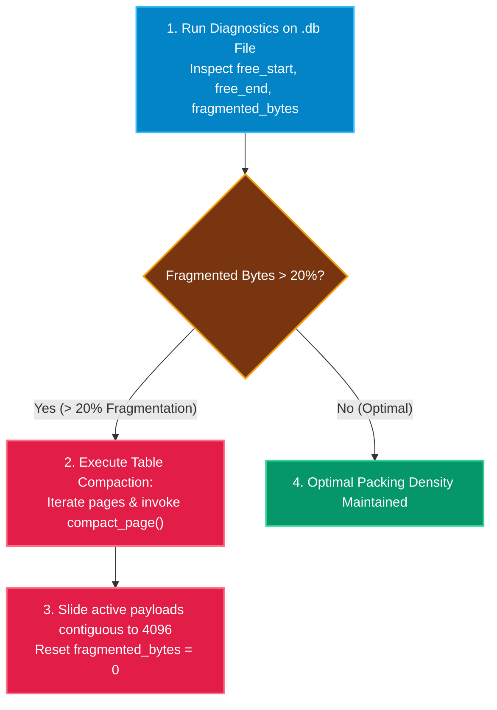

# Operations & Maintenance Guide ⚙️

Operational procedures for administering, backing up, compacting, and maintaining QuartzDB database files in production.

For detailed runbooks and scripts, see [Backup & Recovery Runbooks](/operations/backup-recovery).

---

## 1. Single-File Storage Overview

QuartzDB stores all tables, catalog definitions, and B+ Tree index nodes in a **single `.db` file**:
- **Fixed 4KB Pages**: All reads and writes operate on strict 4096-byte boundaries.
- **Catalog Page 0**: Houses root pointers, schema registries, and table metadata.
- **Atomic Operations**: Pager writes ensure single-file consistency across operating system crashes.

---

## 2. Backup Procedures

### Cold / Offline Backups
```bash
# 1. Pause host service
systemctl stop my_service

# 2. Copy the database file
cp /var/data/quartz/prod_orders.db /backups/quartz/prod_orders_$(date +%Y%m%d).db

# 3. Restart host service
systemctl start my_service
```

### Snapshotting with Filesystem Locks
For 24/7 continuous workloads, execute copy-on-write volume snapshots (e.g., LVM snapshots, ZFS snapshots, or AWS EBS volume snapshots).

---

## 3. Storage Compaction Runbook

When records are updated or deleted, slotted pages accumulate `fragmented_bytes`:



### Compaction Mechanics
Inside `src/storage/table.cpp`:
1. `compact_page()` allocates a clean temporary 4KB buffer.
2. Active slots (where `length > 0`) are written to the slot array.
3. Payloads are copied back-to-front starting at offset 4096.
4. Deleted slots (`length == 0`) remain tombstones to preserve `RecordID` stability, while the payload bytes are completely reclaimed.

---

## 4. Disaster Recovery & Health Verification

If a database file experiences an unexpected power loss:

```bash
# Verify magic bytes and page size alignment using quartz CLI:
./quartz my_database.db
```

Inside the CLI, run integrity checks:
```sql
-- Verify catalog can be read
SHOW TABLES;

-- Inspect schema
.schema orders

-- Verify primary index B+ tree invariants
SELECT COUNT(*) FROM orders;
```
If the magic number is valid (`0x31424451` "QDB1"), QuartzDB successfully mounts Page 0 and loads the catalog.
