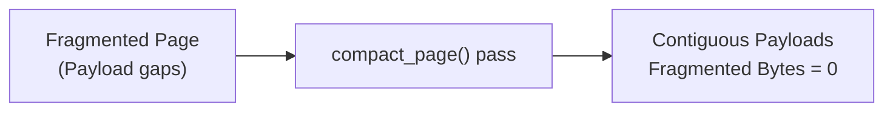

# Backup & Recovery Runbooks 🛡️

Operational procedures for backing up, restoring, compacting, and recovering QuartzDB databases in production environments.

---

## Single-File Cold Backups

Because all table records, schema definitions, and B+ tree index nodes persist in a unified `.db` file, backups require no complex dump streaming:

```bash
# 1. Stop host application service or pause write transactions
systemctl stop my_app

# 2. Copy the single binary database file
cp /var/data/quartz/production.db /backups/quartz/production_$(date +%Y%m%d).db

# 3. Resume service
systemctl start my_app
```

---

## File Recovery & Integrity Validation

If a database file experiences an unexpected process termination, verify its integrity by reading Page 0:

```bash
# Attempt to open database with CLI
./quartz production.db
```

In the CLI:
```sql
-- 1. Check if catalog loads (validates magic bytes QDB1 = 0x31424451)
SHOW TABLES;

-- 2. Validate primary index B+ tree traversability
SELECT COUNT(*) FROM users;
```

---

## Storage Compaction

When records are updated or deleted, slotted pages accumulate `fragmented_bytes`. While QuartzDB automatically compacts individual pages during insertions when space is tight, administrators can also run compaction to optimize file density:


