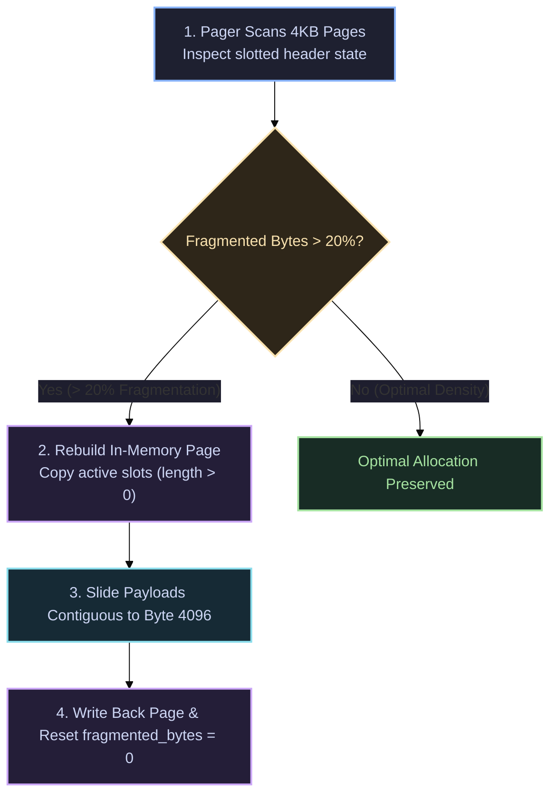

# Backup & Recovery Runbooks 🛡️

Operational procedures for administering, backing up, compacting, and recovering QuartzDB database files in production environments.

---

## 1. Single-File Storage Architecture

QuartzDB consolidates all database state into a **single binary file** (e.g. `production.db`):
- **Page 0**: System Catalog, schema definitions, and table root pointers.
- **Pages $1 \dots N$**: 4KB slotted data pages and disk-backed B+ Tree index nodes.
- **Header Magic**: Constant `0x31424451` (`"QDB1"`) in database files and `0x31475051` (`"QPG1"`) on individual pages.

Because no separate transaction journals or auxiliary catalog files exist, backup and restore procedures are fundamentally atomic at the file boundary.

---

## 2. Backup Procedures

### 2.1 Cold / Offline Backups (Recommended)

When host application services can be paused briefly:

```bash
# 1. Stop host application service or pause write transactions
systemctl stop quartz_service

# 2. Copy the single binary database file with a timestamp
cp /var/data/quartz/production.db /backups/quartz/production_$(date +%Y%m%d_%H%M%S).db

# 3. Resume host application service
systemctl start quartz_service
```

On Windows (PowerShell):
```powershell
Stop-Service QuartzHostApp
Copy-Item "C:\data\quartz\production.db" -Destination "D:\backups\quartz\prod_$(Get-Date -Format 'yyyyMMdd_HHmmss').db"
Start-Service QuartzHostApp
```

### 2.2 Online Snapshots (Zero-Downtime)

For 24/7 continuous workloads where stopping the engine is not feasible:
1. **Linux LVM / ZFS**: Create an atomic copy-on-write snapshot of the underlying filesystem volume:
   ```bash
   lvcreate -L 10G -s -n quartz_snap /dev/vg0/quartz_data
   dd if=/dev/vg0/quartz_snap of=/backups/quartz/snapshot.img bs=4M status=progress
   lvremove -y /dev/vg0/quartz_snap
   ```
2. **Cloud Volume Snapshots**: Use AWS EBS, Google Cloud Persistent Disk, or Azure Managed Disk snapshots. Because 4KB pager operations issue atomic sector writes, volume snapshots yield crash-consistent images.

---

## 3. Storage Compaction Runbook

When tuples are updated or deleted (`length = 0`), slotted pages accumulate `fragmented_bytes`. While QuartzDB automatically executes `compact_page()` when available contiguous space is insufficient for an insertion, administrators can monitor and optimize physical page density.

### Compaction Mechanics



Inside `src/storage/table.cpp`:
1. `compact_page()` allocates a clean temporary 4096-byte buffer.
2. Active slots (where `length > 0`) are assigned contiguous offsets starting backward from byte 4096.
3. Tombstone slots (where `length == 0`) remain in the slot array to preserve **`RecordID`** indirection stability, while payload bytes are reclaimed.
4. `free_end` is recalculated and `fragmented_bytes` is reset to 0.

---

## 4. Disaster Recovery & Integrity Verification Checklist

If a database file experiences an unclean host shutdown or sudden power loss, follow this step-by-step verification protocol:

### Step 1: Binary Header Validation
Verify that the database file is aligned to 4096-byte page boundaries and contains valid magic bytes:

```bash
# Check file size is divisible by 4096:
python3 -c "import os; sz = os.path.getsize('production.db'); print('Size:', sz, 'Pages:', sz/4096, 'Aligned:', sz % 4096 == 0)"
```

### Step 2: Catalog Mount & Schema Inspection
Launch the interactive CLI against the target database:

```bash
./quartz production.db
```

Inside the CLI REPL:
```sql
-- 1. Verify Catalog Page 0 loads and displays registered tables
SHOW TABLES;

-- 2. Validate schema definitions for all core tables
.schema users
.schema orders
.schema products

-- 3. Verify database allocation statistics
.db
```

### Step 3: Primary Index Traversability
Execute point lookups and full count scans to traverse the on-disk B+ Tree:

```sql
-- Validates root-to-leaf traversal across all index levels:
SELECT COUNT(*) FROM users;

-- Test point lookup via B+ Tree fast-path:
SELECT * FROM users WHERE id = 1;
```

If `SHOW TABLES` returns the expected tables and primary key queries succeed, the database file is confirmed healthy and ready for production traffic.

---

## 5. Automated Backup Cron Script

Save this script as `/usr/local/bin/backup-quartz.sh` for automated daily backups:

```bash
#!/usr/bin/env bash
set -euo pipefail

DB_PATH="/var/data/quartz/production.db"
BACKUP_DIR="/backups/quartz"
TIMESTAMP=$(date +"%Y%m%d_%H%M%S")
BACKUP_FILE="${BACKUP_DIR}/prod_${TIMESTAMP}.db"

mkdir -p "${BACKUP_DIR}"

echo "[INFO] Starting QuartzDB backup: ${TIMESTAMP}"
cp "${DB_PATH}" "${BACKUP_FILE}"

# Retain backups for 14 days
find "${BACKUP_DIR}" -name "prod_*.db" -mtime +14 -delete

echo "[INFO] Backup complete: ${BACKUP_FILE}"
```
