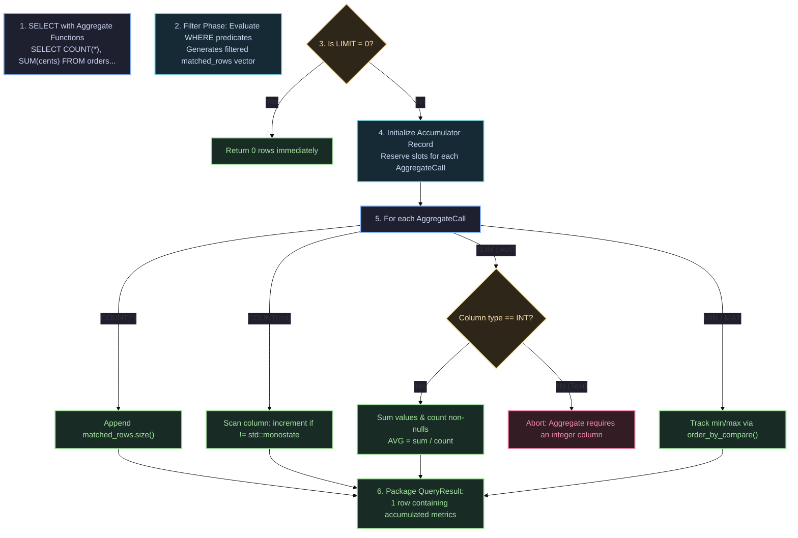

# Aggregate Functions 📊

QuartzDB supports standard SQL aggregate functions for calculating statistical summaries across tables and filtered result sets.

---

## Syntax Diagram

<SyntaxRailroad title="Aggregate Function Syntax Grammar" viewBox="0 0 680 90">
  <path d="M 20 45 L 60 45" class="track" />

  <!-- Aggregate Function Names Branch -->
  <path d="M 60 45 L 80 20 L 100 20" class="track" />
  <path d="M 60 45 L 80 45 L 100 45" class="track" />
  <path d="M 60 45 L 80 70 L 100 70" class="track" />

  <!-- Functions -->
  <rect x="100" y="8" width="90" height="24" rx="4" class="token-box keyword" />
  <text x="145" y="20" class="token-text keyword">COUNT</text>

  <rect x="100" y="33" width="90" height="24" rx="4" class="token-box keyword" />
  <text x="145" y="45" class="token-text keyword">SUM | AVG</text>

  <rect x="100" y="58" width="90" height="24" rx="4" class="token-box keyword" />
  <text x="145" y="70" class="token-text keyword">MIN | MAX</text>

  <path d="M 190 20 L 210 20 L 230 45" class="track" />
  <path d="M 190 45 L 230 45" class="track" />
  <path d="M 190 70 L 210 70 L 230 45" class="track" />

  <!-- ( -->
  <rect x="230" y="33" width="25" height="24" rx="4" class="token-box" />
  <text x="242" y="45" class="token-text">(</text>
  <path d="M 255 45 L 285 45" class="track" />

  <!-- Argument: * or column -->
  <rect x="285" y="20" width="30" height="24" rx="4" class="token-box" />
  <text x="300" y="32" class="token-text">*</text>

  <rect x="285" y="48" width="80" height="24" rx="4" class="token-box" />
  <text x="325" y="60" class="token-text">column</text>

  <path d="M 315 32 L 385 32 L 385 45" class="track" />
  <path d="M 365 60 L 385 60 L 385 45" class="track" />

  <!-- ) -->
  <rect x="385" y="33" width="25" height="24" rx="4" class="token-box" />
  <text x="397" y="45" class="token-text">)</text>
  <path d="M 410 45 L 450 45" class="track" />
</SyntaxRailroad>

---

## Supported Aggregate Functions

| Function | Argument | Supported Types | Semantics & Return Behavior |
| :--- | :---: | :--- | :--- |
| **`COUNT(*)`** | `*` | Any | Returns total matching rows ($N \ge 0$). Returns `0` if empty. |
| **`COUNT(col)`** | Column | `INT`, `TEXT` | Counts rows where `col` is not `NULL`. |
| **`SUM(col)`** | Column | `INT` only | Computes 64-bit integer sum. Returns `NULL` if 0 rows matched. |
| **`AVG(col)`** | Column | `INT` only | Computes integer quotient `sum / count`. Returns `NULL` if 0 rows. |
| **`MIN(col)`** | Column | `INT`, `TEXT` | Minimum non-null value (numeric or lexicographic). |
| **`MAX(col)`** | Column | `INT`, `TEXT` | Maximum non-null value (numeric or lexicographic). |

---

## How Aggregations Work Under the Hood in QuartzDB

Aggregation in QuartzDB is implemented inside `src/execution/executor.cpp` (`evaluate_aggregates()`):



### Key Engine Invariants:
1. **Single-Pass In-Memory Reduction**: Once candidate tuples are filtered from the slotted pages or index scan, QuartzDB executes a single continuous pass through memory.
2. **Strict Integer Typing for Arithmetic**: `SUM()` and `AVG()` reject `TEXT` columns at runtime with a descriptive message rather than silently converting or returning garbage values.
3. **Null-Safe Accumulation**: `NULL` (`std::monostate`) values are excluded from `COUNT(col)`, `SUM`, `AVG`, `MIN`, and `MAX`. If all rows evaluate to `NULL`, `SUM`, `AVG`, `MIN`, and `MAX` yield `NULL`.
4. **Multiple Aggregations in One Statement**: Any combination of aggregates can be requested simultaneously:
   ```sql
   SELECT COUNT(*), SUM(total_cents), AVG(total_cents), MIN(total_cents), MAX(total_cents)
   FROM orders
   WHERE status = 'PAID';
   ```

---

## Practical Examples

### 1. Count All Records ($O(\log N)$ or Full Scan)
```sql
SELECT COUNT(*) FROM users;
```

### 2. Multi-Metric Financial Summary
```sql
SELECT COUNT(*), SUM(total_cents), AVG(total_cents) 
FROM orders 
WHERE status = 'PAID';
```

### 3. Aggregate over Relational JOIN
```sql
SELECT COUNT(*), SUM(orders.total_cents)
FROM users
JOIN orders ON users.id = orders.user_id
WHERE users.active = 1;
```
