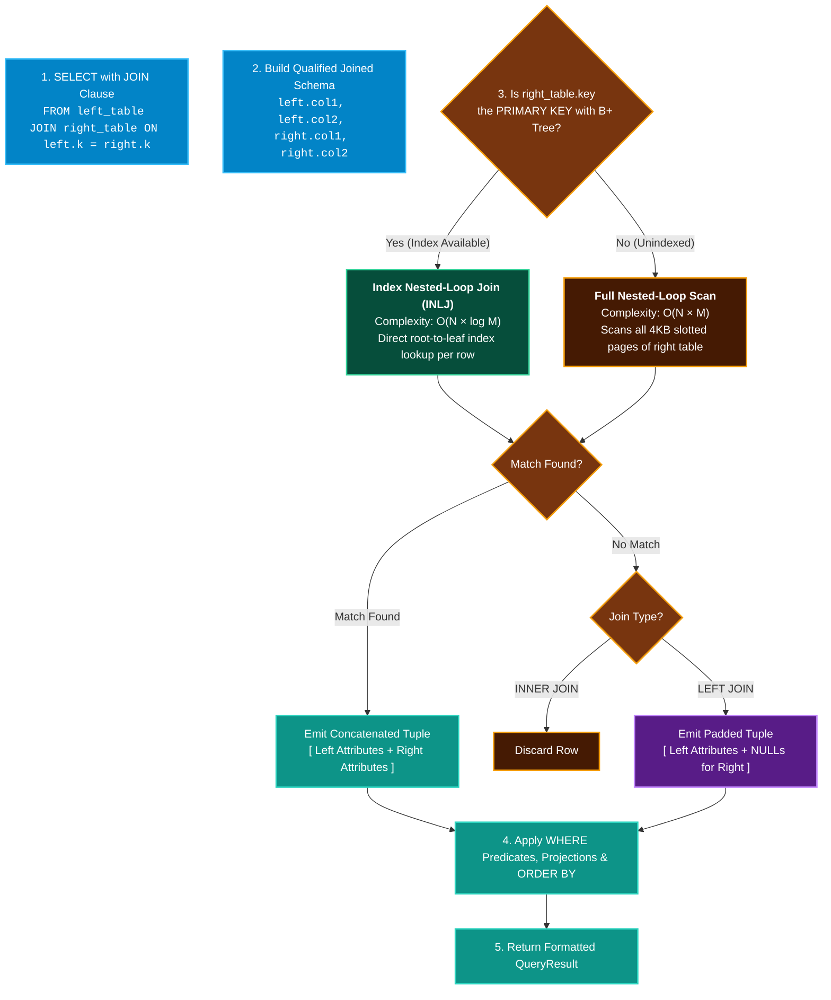

# Relational JOIN Operations 🔗

QuartzDB supports multi-table relational queries via **`INNER JOIN`** and **`LEFT JOIN`**, equipped with an automatic **Index Nested-Loop Join (INLJ)** engine optimization.

---

## Syntax Diagram

<SyntaxRailroad title="JOIN Clause Railroad Grammar" viewBox="0 0 740 90">
  <path d="M 20 45 L 60 45" class="track" />

  <!-- JOIN Type Branch -->
  <path d="M 60 45 L 80 25 L 100 25" class="track" />
  <path d="M 60 45 L 100 45" class="track" />
  <path d="M 60 45 L 80 65 L 100 65" class="track" />

  <rect x="100" y="13" width="90" height="24" rx="4" class="token-box keyword" />
  <text x="145" y="25" class="token-text keyword">INNER JOIN</text>

  <rect x="100" y="33" width="90" height="24" rx="4" class="token-box keyword" />
  <text x="145" y="45" class="token-text keyword">JOIN</text>

  <rect x="100" y="53" width="90" height="24" rx="4" class="token-box keyword" />
  <text x="145" y="65" class="token-text keyword">LEFT JOIN</text>

  <path d="M 190 25 L 210 25 L 230 45" class="track" />
  <path d="M 190 45 L 230 45" class="track" />
  <path d="M 190 65 L 210 65 L 230 45" class="track" />

  <!-- Target Table -->
  <rect x="230" y="33" width="90" height="24" rx="4" class="token-box" />
  <text x="275" y="45" class="token-text">right_table</text>
  <path d="M 320 45 L 350 45" class="track" />

  <!-- ON Keyword -->
  <rect x="350" y="33" width="40" height="24" rx="4" class="token-box keyword" />
  <text x="370" y="45" class="token-text keyword">ON</text>
  <path d="M 390 45 L 420 45" class="track" />

  <!-- Condition: left.col = right.col -->
  <rect x="420" y="33" width="220" height="24" rx="4" class="token-box" />
  <text x="530" y="45" class="token-text">left.col = right.col</text>
  <path d="M 640 45 L 700 45" class="track" />
</SyntaxRailroad>

---

## Supported Join Types

| Join Keyword | Semantic Behavior | Unmatched Left Rows | Unmatched Right Rows |
| :--- | :--- | :---: | :---: |
| **`INNER JOIN`** (or `JOIN`) | Emits rows only when the `ON` equality predicate matches both tables. | Discarded | Discarded |
| **`LEFT JOIN`** | Emits all left table rows. Fills right table columns with `NULL` (`std::monostate`) when no match exists. | Preserved (padded with `NULL`) | Discarded |

---

## How JOIN Works Under the Hood in QuartzDB

Relational joins are evaluated in `src/execution/executor.cpp` (`execute_select_join()`):



### 1. Index Nested-Loop Join (INLJ) Fast-Path
When the join predicate equates a foreign key column to the **`PRIMARY KEY`** of the right table (e.g. `orders.user_id = users.id`):
- Instead of scanning every slotted page in `users` ($O(N \times M)$), QuartzDB extracts the integer key from the left row and calls:
  ```cpp
  auto find_res = right_table->find_by_primary_key(pk_key);
  ```
- This descends the on-disk B+ Tree in **$O(\log M)$** page reads. For 100,000 orders and 50,000 users, INLJ executes in milliseconds rather than minutes!

### 2. Qualified Column Naming & Wildcard Expansions
When tables are joined, column names are qualified by their table name:
- `users.id`, `users.name`
- `orders.id`, `orders.total_cents`, `orders.status`

Projections support:
- `SELECT *`: Emits all columns from both tables.
- `SELECT users.*`: Emits all columns from `users`.
- `SELECT orders.*`: Emits all columns from `orders`.
- `SELECT users.name, orders.total_cents`: Explicit attribute list.

---

## Practical Examples

### 1. Basic INNER JOIN
```sql
SELECT orders.id, users.name, orders.total_cents
FROM orders
JOIN users ON orders.user_id = users.id
WHERE orders.status = 'PAID';
```

### 2. LEFT JOIN with NULL Handling
Preserves customers who have not placed any orders yet:
```sql
SELECT users.name, orders.id, orders.total_cents
FROM users
LEFT JOIN orders ON users.id = orders.user_id;
```
If a customer has no orders, `orders.id` and `orders.total_cents` evaluate to `NULL`.

### 3. JOIN with Aggregations
```sql
SELECT users.name, COUNT(*), SUM(orders.total_cents)
FROM users
JOIN orders ON users.id = orders.user_id
WHERE orders.status = 'PAID';
```
