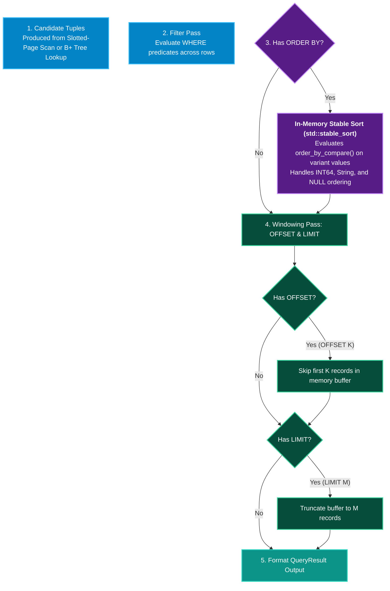

# ORDER BY, LIMIT & OFFSET 📄

QuartzDB provides row ordering and result windowing clauses for sorting query outputs and implementing zero-copy paginated API responses.

---

## Syntax Diagram

<SyntaxRailroad title="ORDER BY & LIMIT / OFFSET Syntax Grammar" viewBox="0 0 740 90">
  <path d="M 20 45 L 50 45" class="track" />

  <!-- Optional ORDER BY Branch -->
  <path d="M 50 45 L 80 20 L 100 20" class="track" />
  <rect x="100" y="8" width="85" height="24" rx="4" class="token-box keyword" />
  <text x="142" y="20" class="token-text keyword">ORDER BY</text>
  <path d="M 185 20 L 205 20" class="track" />

  <rect x="205" y="8" width="60" height="24" rx="4" class="token-box" />
  <text x="235" y="20" class="token-text">column</text>
  <path d="M 265 20 L 285 20" class="track" />

  <!-- ASC / DESC -->
  <rect x="285" y="8" width="90" height="24" rx="4" class="token-box keyword" />
  <text x="330" y="20" class="token-text keyword">ASC | DESC</text>
  <path d="M 375 20 L 400 20 L 415 45" class="track" />

  <!-- Bypass ORDER BY -->
  <path d="M 50 45 L 415 45" class="track" />

  <!-- Optional LIMIT -->
  <path d="M 415 45 L 440 25 L 460 25" class="track" />
  <rect x="460" y="13" width="55" height="24" rx="4" class="token-box keyword" />
  <text x="487" y="25" class="token-text keyword">LIMIT</text>
  <path d="M 515 25 L 530 25" class="track" />
  <rect x="530" y="13" width="40" height="24" rx="4" class="token-box" />
  <text x="550" y="25" class="token-text">count</text>
  <path d="M 570 25 L 590 25 L 600 45" class="track" />

  <!-- Optional OFFSET -->
  <path d="M 600 45 L 615 25 L 630 25" class="track" />
  <rect x="630" y="13" width="60" height="24" rx="4" class="token-box keyword" />
  <text x="660" y="25" class="token-text keyword">OFFSET</text>
  <path d="M 690 25 L 700 25" class="track" />
  <rect x="700" y="13" width="30" height="24" rx="4" class="token-box" />
  <text x="715" y="25" class="token-text">skip</text>
  <path d="M 730 25 L 735 45" class="track" />

  <!-- Bypass LIMIT / OFFSET -->
  <path d="M 415 45 L 735 45" class="track" />
</SyntaxRailroad>

---

## Clause Specifications

| Clause | Arguments | Default | Description |
| :--- | :--- | :---: | :--- |
| **`ORDER BY`** | `column [ASC \| DESC]` | `ASC` | Sorts rows by target column in ascending (`ASC`) or descending (`DESC`) order. |
| **`LIMIT`** | `count` (positive integer) | None | Restricts the maximum number of rows returned in the result set. |
| **`OFFSET`** | `skip` (positive integer) | `0` | Skips the first `skip` rows before beginning to return results. |

---

## How Sorting & Windowing Work in QuartzDB

Sorting and pagination execute in the final stages of the query pipeline inside `src/execution/executor.cpp`:



### Type-Safe Comparisons (`order_by_compare()`)
Inside `src/execution/executor.cpp`:
- **Integers**: Compared with standard numeric relational operators (`<` or `>`).
- **Strings**: Compared lexicographically by UTF-8 byte values.
- **Null Safety**: `NULL` (`std::monostate`) values are sorted lowest in ascending order.
- **Stability**: `std::stable_sort` preserves the relative order of records with equal sort keys.

---

## Practical Examples

### 1. Simple Sort Ascending
```sql
SELECT id, name, salary FROM employees ORDER BY salary ASC;
```

### 2. High-to-Low Ranking with LIMIT
```sql
SELECT id, name, score FROM leaderboard ORDER BY score DESC LIMIT 10;
```

### 3. Paginated API Output (Page 3 with 20 items per page)
```sql
SELECT id, title, created_at 
FROM posts 
ORDER BY id ASC 
LIMIT 20 OFFSET 40;
```

### 4. Combined Filter, Sort and Pagination
```sql
SELECT orders.id, users.name, orders.total_cents
FROM orders
JOIN users ON orders.user_id = users.id
WHERE orders.status = 'PAID'
ORDER BY orders.total_cents DESC
LIMIT 5 OFFSET 0;
```
