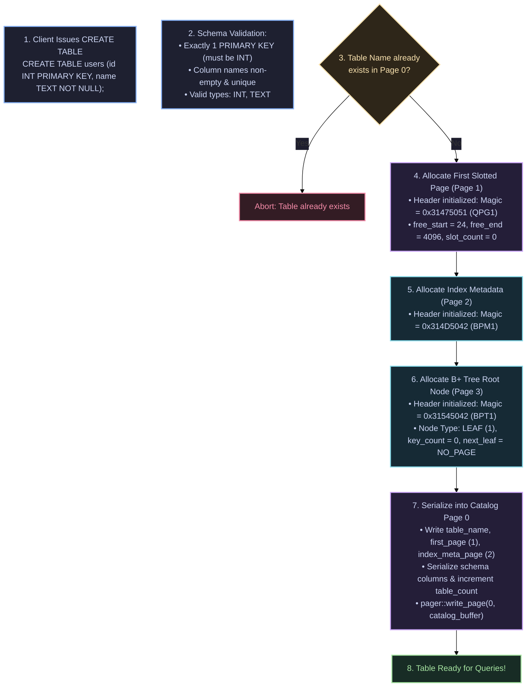
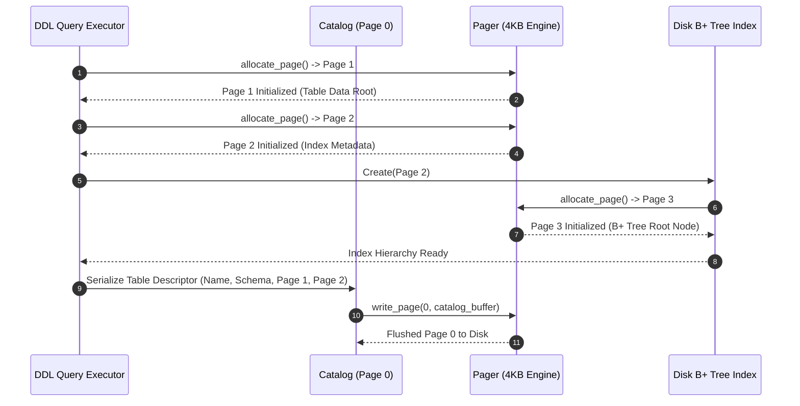

# CREATE TABLE 🏗️

The `CREATE TABLE` statement defines a new relational table, registers its schema into Catalog Page 0, initializes the first 4KB slotted data page, and allocates a new disk B+ Tree for primary key index lookups.

---

## Syntax Diagram

<SyntaxRailroad title="CREATE TABLE Railroad Grammar" viewBox="0 0 680 80">
  <path d="M 20 40 L 50 40" class="track" />

  <!-- CREATE TABLE -->
  <rect x="50" y="24" width="135" height="32" rx="4" class="token-box keyword" />
  <text x="117" y="40" class="token-text keyword">CREATE TABLE</text>
  <path d="M 185 40 L 210 40" class="track" />

  <!-- Table Name -->
  <rect x="210" y="24" width="85" height="32" rx="4" class="token-box" />
  <text x="252" y="40" class="token-text">table</text>
  <path d="M 295 40 L 320 40" class="track" />

  <!-- Column Definitions (...) -->
  <rect x="320" y="24" width="280" height="32" rx="4" class="token-box" />
  <text x="460" y="40" class="token-text">( col_1 type [constraints], ... )</text>
  <path d="M 600 40 L 620 40" class="track" />

  <!-- Semicolon -->
  <rect x="620" y="25" width="25" height="30" rx="4" class="token-box keyword" />
  <text x="632" y="40" class="token-text keyword">;</text>
  <path d="M 645 40 L 670 40" class="track" />
</SyntaxRailroad>

---

## Column Constraints

| Constraint | Syntax | Description |
| :--- | :--- | :--- |
| **`PRIMARY KEY`** | `col_name INT PRIMARY KEY` | Designates the 64-bit integer index key. Exactly one column per table must declare this. |
| **`NOT NULL`** | `col_name TEXT NOT NULL` | Rejects `NULL` insertions during execution. |

---

## How CREATE TABLE Works Under the Hood in QuartzDB

Table creation coordinates schema validation, 4KB page allocation, B+ tree root construction, and Catalog Page 0 persistence:



### Allocation Flow Sequence

<div class="diagram-full">



</div>

---

## Practical Examples

### 1. Basic Table with Primary Key
```sql
CREATE TABLE users (
    id INT PRIMARY KEY,
    name TEXT NOT NULL,
    email TEXT
);
```

### 2. Multi-Column Relational Table
```sql
CREATE TABLE orders (
    id INT PRIMARY KEY,
    user_id INT NOT NULL,
    total_cents INT NOT NULL,
    status TEXT NOT NULL
);
```
