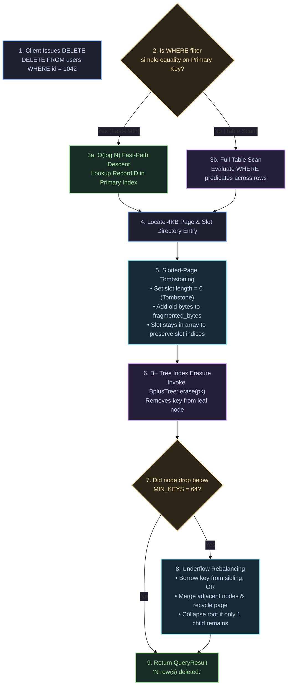

# DELETE 🗑️

The `DELETE` statement removes records from a table matching an optional `WHERE` predicate filter.

---

## Syntax Diagram

<SyntaxRailroad title="DELETE Statement Railroad Grammar" viewBox="0 0 620 80">
  <path d="M 20 40 L 50 40" class="track" />

  <!-- DELETE FROM -->
  <rect x="50" y="24" width="130" height="32" rx="4" class="token-box keyword" />
  <text x="115" y="40" class="token-text keyword">DELETE FROM</text>
  <path d="M 180 40 L 205 40" class="track" />

  <!-- Table -->
  <rect x="205" y="24" width="80" height="32" rx="4" class="token-box" />
  <text x="245" y="40" class="token-text">table</text>
  <path d="M 285 40 L 310 40" class="track" />

  <!-- WHERE Clause -->
  <rect x="310" y="24" width="220" height="32" rx="4" class="token-box" />
  <text x="420" y="40" class="token-text">WHERE condition_expr</text>
  <path d="M 530 40 L 555 40" class="track" />

  <!-- Semicolon -->
  <rect x="555" y="25" width="25" height="30" rx="4" class="token-box keyword" />
  <text x="567" y="40" class="token-text keyword">;</text>
  <path d="M 580 40 L 610 40" class="track" />
</SyntaxRailroad>

---

## How DELETE Works Under the Hood in QuartzDB

Deletion coordinates slotted-page tombstoning, space fragmentation tracking, and B+ tree structural rebalancing:



### Detailed Deletion Mechanics:
1. **Fast-Path $O(\log N)$ Point Deletion**:
   When deleting by primary key (`WHERE id = ?`), the executor queries the B+ Tree directly to obtain `RecordID {page_id, slot_index}`. The 4KB data page is fetched, avoiding a full table scan.
2. **Slot Tombstoning**:
   - The slot's `record_length` is zeroed (`length = 0`), marking it as a tombstone.
   - The payload size is added to the page header's `fragmented_bytes`.
   - The slot entry **remains allocated in the slot directory** to ensure that other records' slot indices are not disturbed.
3. **B+ Tree Underflow & Node Merging (`include/index/bplus_tree.hpp`)**:
   - When a key is erased from a leaf node and its key count drops below `MIN_KEYS = 64`, the B+ Tree engine checks adjacent siblings.
   - If a sibling has spare keys, it **borrows** a key and updates the parent separator.
   - If siblings cannot spare keys, the engine **merges** the two nodes into one 4KB page, freeing the empty page directly into the pager's `free_pages` recycling pool.
   - If the root node shrinks to 1 child, the root collapses and its child is promoted.
4. **Physical Reclamation**:
   When new insertions require space, or during manual table maintenance, `compact_page()` slides remaining active payloads contiguous to byte 4096, resetting `fragmented_bytes = 0`.

---

## Practical Examples

### 1. Delete by Primary Key ($O(\log N)$ Fast-Path)
```sql
DELETE FROM users WHERE id = 1042;
```

### 2. Delete with Boolean Comparison Predicate
```sql
DELETE FROM orders WHERE status = 'CANCELLED' OR total_cents = 0;
```

### 3. Delete All Rows in Table
```sql
DELETE FROM staging_events;
```
