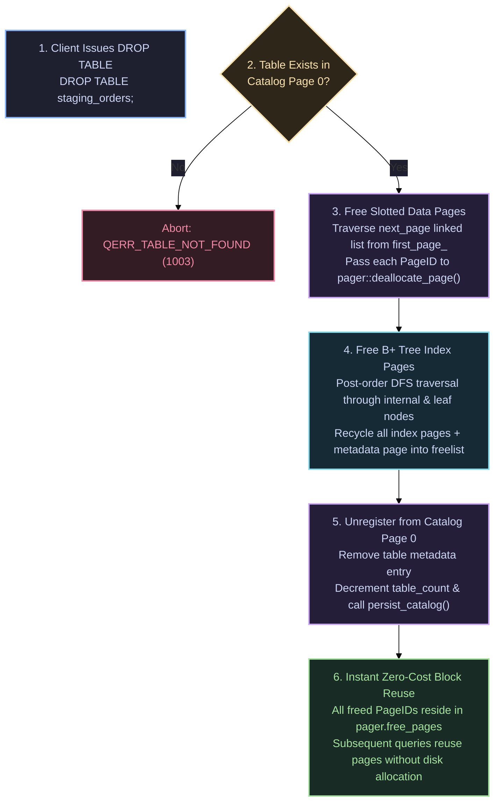

# DROP TABLE 🗑️

The `DROP TABLE` statement deletes a registered table from the database catalog, deallocates its slotted data pages, tears down its B+ Tree index, and reclaims all pages into the pager's freelist.

---

## Syntax Diagram

<SyntaxRailroad title="DROP TABLE Railroad Grammar" viewBox="0 0 520 80">
  <path d="M 20 40 L 50 40" class="track" />

  <!-- DROP TABLE -->
  <rect x="50" y="24" width="120" height="32" rx="4" class="token-box keyword" />
  <text x="110" y="40" class="token-text keyword">DROP TABLE</text>
  <path d="M 170 40 L 200 40" class="track" />

  <!-- Table Name -->
  <rect x="200" y="24" width="90" height="32" rx="4" class="token-box" />
  <text x="245" y="40" class="token-text">table</text>
  <path d="M 290 40 L 320 40" class="track" />

  <!-- Semicolon -->
  <rect x="320" y="25" width="25" height="30" rx="4" class="token-box keyword" />
  <text x="332" y="40" class="token-text keyword">;</text>
  <path d="M 345 40 L 380 40" class="track" />
</SyntaxRailroad>

---

## How DROP TABLE Works Under the Hood in QuartzDB

Dropping a table in QuartzDB cleans up state across Catalog Page 0, data page chains, and B+ tree index hierarchies:



### Detailed Deallocation Stages:
1. **Data Page Chain Teardown (`Table::deallocate_all_pages()`)**:
   Beginning at `first_page_`, the engine reads each page header to discover the `next_page` pointer, unlinks the frame, and returns each `PageID` to `pager_.deallocate_page()`.
2. **Index Tree Teardown (`BplusTree::deallocate_all_pages()`)**:
   Recursively traverses internal routing pages and leaf pages in post-order depth-first search, guaranteeing that all child pages are freed before parent pages. The dedicated index metadata page is also freed.
3. **Catalog Compaction (`Database::persist_catalog()`)**:
   Catalog Page 0 is updated by decrementing `table_count` and rewriting the serialized table descriptor entries contiguous to offset 12 (`CATALOG_HEADER_SIZE`).
4. **Immediate Space Reuse**:
   Because all freed `PageID` values are pushed directly to the pager's `free_pages` stack, subsequent `CREATE TABLE` or `INSERT` operations immediately allocate from this pool with $O(1)$ efficiency.

---

## Practical Examples

```sql
-- Drop table and reclaim all 4KB pages
DROP TABLE orders;

-- Verify table is gone
SHOW TABLES;
```
