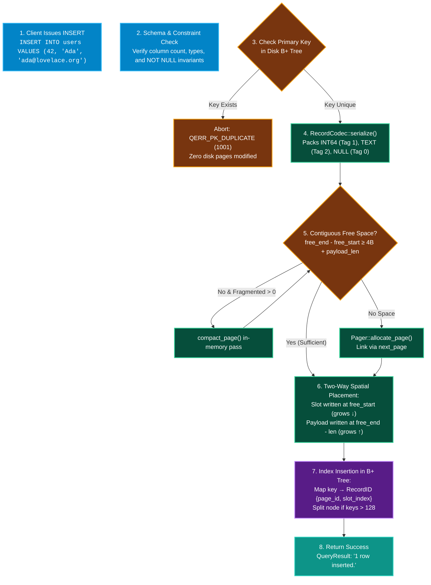

# INSERT

The `INSERT` statement appends a new tuple into a table. The tuple is serialized via `RecordCodec`, stored in the active 4KB slotted page, and indexed into the disk B+ Tree.

---

## Syntax Diagram

<SyntaxRailroad title="INSERT Statement Railroad Grammar" viewBox="0 0 680 80">
  <path d="M 20 40 L 50 40" class="track" />

  <!-- INSERT INTO -->
  <rect x="50" y="24" width="125" height="32" rx="4" class="token-box keyword" />
  <text x="112" y="40" class="token-text keyword">INSERT INTO</text>
  <path d="M 175 40 L 205 40" class="track" />

  <!-- Table Name -->
  <a href="#table-target">
    <rect x="205" y="24" width="85" height="32" rx="4" class="token-box" />
    <text x="247" y="40" class="token-text">table</text>
  </a>
  <path d="M 290 40 L 320 40" class="track" />

  <!-- VALUES Token -->
  <rect x="320" y="24" width="80" height="32" rx="4" class="token-box keyword" />
  <text x="360" y="40" class="token-text keyword">VALUES</text>
  <path d="M 400 40 L 420 40" class="track" />

  <!-- Values Tuple (...) -->
  <a href="#values-tuple">
    <rect x="420" y="24" width="180" height="32" rx="4" class="token-box" />
    <text x="510" y="40" class="token-text">( val_1, val_2, ... )</text>
  </a>
  <path d="M 600 40 L 620 40" class="track" />

  <!-- Terminal Semicolon -->
  <rect x="620" y="25" width="25" height="30" rx="4" class="token-box keyword" />
  <text x="632" y="40" class="token-text keyword">;</text>
  <path d="M 645 40 L 670 40" class="track" />
</SyntaxRailroad>

---

## Clauses & Rules

### 1. Table Target (`#table-target`) {#table-target}
Must specify a valid table registered in Catalog Page 0.

### 2. Values Tuple (`#values-tuple`) {#values-tuple}
- **Value Count**: Must match the exact number of columns defined in the table schema.
- **Type Coercion**: Values must conform to `INT64`, `TEXT` (strings in quotes), or `NULL`.

---

## How INSERT Works Under the Hood in QuartzDB

Tuple insertion coordinates schema validation, slotted-page two-way spatial allocation, and disk B+ tree indexing:



### Detailed Execution Stages:
1. **Schema Reordering**: If optional column names are specified (`INSERT INTO users (email, id, name)`), the parser maps values into canonical table schema column ordering; missing nullable columns are populated with `NULL`.
2. **Pre-Write Primary Key Guard**: Before modifying any 4KB data pages, QuartzDB verifies primary key uniqueness directly against the on-disk B+ Tree. If a conflict occurs, the operation immediately aborts without leaving dirty partial records.
3. **Slotted-Page Allocation**:
   - `Slot { offset, length }` is recorded at offset `free_start` (grows downward).
   - Dynamic bytes are written backward from `free_end` (grows upward).
4. **B+ Tree Leaf Indexing**: The resulting `RecordID {page_id, slot_index}` is inserted into the primary index. If the leaf node reaches `MAX_KEYS = 128`, it triggers a leaf split, promotes the median separator key to its internal parent, and links the sibling leaf via `next_leaf`.

---

## Engine Invariants

1. **Primary Key Uniqueness**: If the primary key value already exists in the `PrimaryIndex` B+ Tree, insertion fails with error `QERR_PK_DUPLICATE` (1001).
2. **Payload Limit**: Serialized tuple bytes cannot exceed 4068 bytes. Larger payloads trigger `QERR_RECORD_TOO_LARGE` (1004).
3. **Automatic Page Compaction**: If the active slotted page has accumulated fragmented gap bytes (`fragmented_bytes > 0`), QuartzDB executes `compact_page()` in-memory before requesting a new 4KB page allocation.

---

## Examples

### Standard Insert
```sql
INSERT INTO users VALUES (1, 'Alice Smith', 'alice@example.com');
```

### Insert with NULL Value
```sql
INSERT INTO users VALUES (2, 'Bob Jones', NULL);
```
