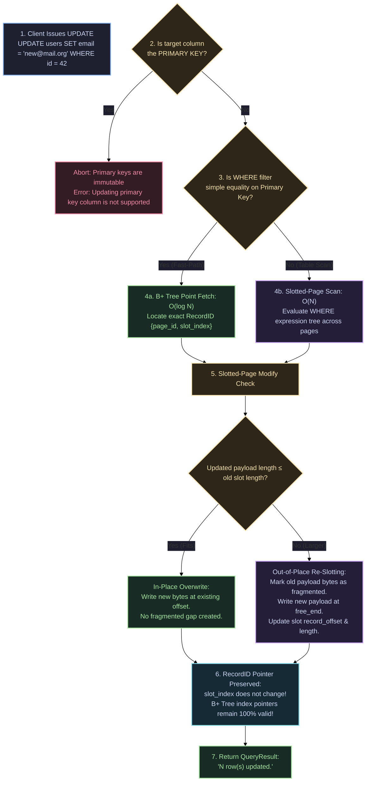

# UPDATE 📝

The `UPDATE` statement modifies column values for records matching an optional `WHERE` predicate filter.

---

## Syntax Diagram

<SyntaxRailroad title="UPDATE Statement Railroad Grammar" viewBox="0 0 680 80">
  <path d="M 20 40 L 50 40" class="track" />

  <!-- UPDATE -->
  <rect x="50" y="24" width="80" height="32" rx="4" class="token-box keyword" />
  <text x="90" y="40" class="token-text keyword">UPDATE</text>
  <path d="M 130 40 L 150 40" class="track" />

  <!-- Table -->
  <rect x="150" y="24" width="75" height="32" rx="4" class="token-box" />
  <text x="187" y="40" class="token-text">table</text>
  <path d="M 225 40 L 250 40" class="track" />

  <!-- SET -->
  <rect x="250" y="24" width="55" height="32" rx="4" class="token-box keyword" />
  <text x="277" y="40" class="token-text keyword">SET</text>
  <path d="M 305 40 L 325 40" class="track" />

  <!-- Assignments -->
  <rect x="325" y="24" width="160" height="32" rx="4" class="token-box" />
  <text x="405" y="40" class="token-text">col = val</text>
  <path d="M 485 40 L 505 40" class="track" />

  <!-- WHERE Clause -->
  <rect x="505" y="24" width="105" height="32" rx="4" class="token-box" />
  <text x="557" y="40" class="token-text">WHERE expr</text>
  <path d="M 610 40 L 630 40" class="track" />

  <!-- Semicolon -->
  <rect x="630" y="25" width="25" height="30" rx="4" class="token-box keyword" />
  <text x="642" y="40" class="token-text keyword">;</text>
  <path d="M 655 40 L 675 40" class="track" />
</SyntaxRailroad>

---

## How UPDATE Works Under the Hood in QuartzDB

Updating records in QuartzDB coordinates query execution routing, slotted-page payload resizing, and index pointer stability:



### Detailed Engine Mechanics:
1. **Immutable Primary Key Constraint**: QuartzDB enforces immutable primary keys. To change a primary key, delete the old record and insert a new one. This prevents index fragmentation and preserves foreign-key referential integrity.
2. **Point Fast-Path Optimization**: When updating by primary key (`WHERE id = 42`), the executor bypasses full table scans, descending the disk B+ Tree in $O(\log N)$ to find the targeted 4KB page and slot directly.
3. **In-Place vs Out-of-Place Rewriting**:
   - If the new serialized tuple length is $\le$ the old tuple length, the existing byte range in the page is overwritten in-place.
   - If the new tuple is larger (e.g. updating a short text to a long text), the old space is recorded as `fragmented_bytes`, and the new tuple is allocated from the contiguous free space pool (`free_end`).
4. **Logical Indirection Stability**: Even when records move within the 4KB page, **their `slot_index` never changes**. Thus, external B+ Tree leaf references (`RecordID {PageID, slot_index}`) remain permanently valid without requiring index updates!

---

## Practical Examples

### 1. Update by Primary Key ($O(\log N)$ Fast-Path)
```sql
UPDATE users 
SET email = 'alice.new@company.com' 
WHERE id = 1;
```

### 2. Update with Boolean Predicate
```sql
UPDATE orders 
SET status = 'SHIPPED' 
WHERE status = 'PAID' AND id < 5000;
```
