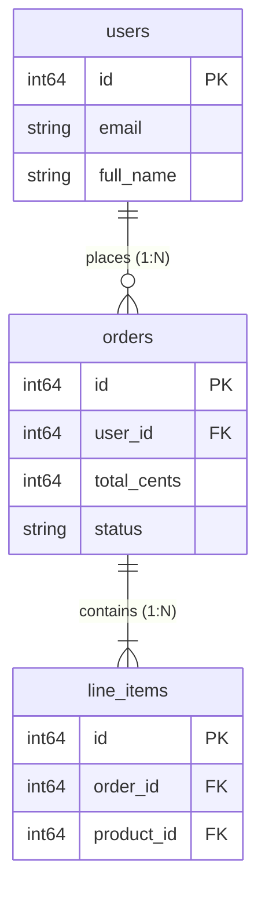

# orders

*Represents customer purchase orders and transaction lifecycles.*  
**Last updated:** `2026-11-13` · **Owner:** `commerce-engineering`

> [!NOTE] Example Schema — Not Engine-Specific
> This page describes the **example sample schema** shipped with QuartzDB for demonstration purposes (`users`, `orders`, `products`). QuartzDB itself does not enforce any predefined business schema, roles, or PII policy. These tables exist solely to illustrate engine capabilities.

---

<!-- Stat Card Wireframe Banner -->
<div class="stat-card-row">
  <div class="stat-card">
    <div class="stat-card-label">Estimated Rows</div>
    <div class="stat-card-val">📊 450,000</div>
  </div>
  <div class="stat-card">
    <div class="stat-card-label">Disk Footprint</div>
    <div class="stat-card-val">📅 est. 18.4 MB</div>
  </div>
  <div class="stat-card">
    <div class="stat-card-label">4KB Pages Allocated</div>
    <div class="stat-card-val">📄 4,710 pgs</div>
  </div>
  <div class="stat-card">
    <div class="stat-card-label">Primary Key Index</div>
    <div class="stat-card-val">🌲 B+ Tree (3 Levels)</div>
  </div>
</div>

---

## Columns

| Column Name | Data Type | Nullable | Badges | Description |
| :--- | :--- | :--- | :--- | :--- |
| <span class="click-copy" onclick="navigator.clipboard.writeText('id')">`id`</span> | `INT64` | `NO` | <span class="badge-pk">PK 🔑</span> | Unique 64-bit primary key index identifier. |
| <span class="click-copy" onclick="navigator.clipboard.writeText('user_id')">`user_id`</span> | `INT64` | `NO` | <span class="badge-fk">FK 🔗</span> | References [users.id](/tables/users). |
| <span class="click-copy" onclick="navigator.clipboard.writeText('total_cents')">`total_cents`</span> | `INT64` | `NO` | — | Gross transaction amount stored in integer cents (USD). |
| <span class="click-copy" onclick="navigator.clipboard.writeText('status')">`status`</span> | `TEXT` | `NO` | — | Order state: `PENDING`, `PAID`, `SHIPPED`, `CANCELLED`. |
| <span class="click-copy" onclick="navigator.clipboard.writeText('placed_at')">`placed_at`</span> | `INT64` | `NO` | — | Epoch millisecond Unix timestamp when order was submitted. |

> [!TIP]
> Click on any column name in the table above to copy it to your clipboard.

---

## Keys & Constraints

- **Primary Key Constraint**: Single-column integer primary key on `id`. Enforces uniqueness at insertion time via `PrimaryIndex::insert()`. Duplicate keys abort with status code `KEY_ALREADY_EXISTS`.
- **Foreign Key Invariant**: `user_id` references valid registered customer records in the `users` table.
- **Nullability**: All five attributes are marked `NOT NULL`. Attempting to insert a `NULL` (`std::monostate`) value raises a schema violation.

---

## Indexes & Access Paths

| Index Name | Indexed Column | Index Type | Height | Complexity | Path Selected |
| :--- | :--- | :--- | :--- | :--- | :--- |
| **`idx_orders_pk`** | `id` | Disk B+ Tree | 3 | $O(\log N)$ | Used for point lookups (`WHERE id = ?`). Fetches record in ~100–250 μs. |
| **Sequential Scan** | `user_id`, `status` | Slotted Page Chain | — | $O(N)$ | Linear traversal across 4KB pages linked via `next_page`. |

---

## Related Tables



- **Parent Table**: [**`users`**](/tables/users) via `orders.user_id = users.id`.
- **Child Table**: [**`line_items`**](/data-dictionary) via `line_items.order_id = orders.id`.

---

## Sample SQL Queries

### Point Query via B+ Tree Index ($O(\log N)$)
```sql
SELECT * FROM orders WHERE id = 1042;
```

### Relational JOIN with Customer Table
```sql
SELECT orders.id, users.full_name, orders.total_cents, orders.status
FROM orders
JOIN users ON orders.user_id = users.id
WHERE orders.status = 'PAID';
```

### Inserting an Order
```sql
INSERT INTO orders VALUES (50001, 12, 14900, 'PENDING', 1731512400000);
```
